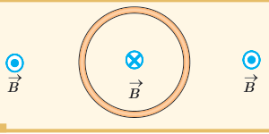
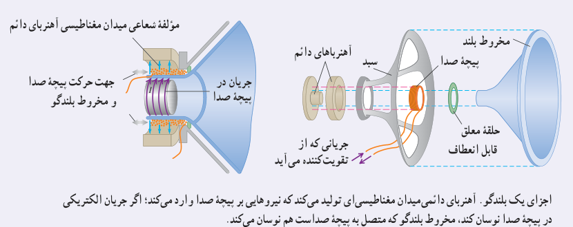
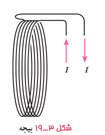

### پرسش ۳ـ۸

شکل روبه‌رو، یک حلقۀ حامل جریان را نشان می‌دهد که جهت خط‌های میدان مغناطیسی درون و بیرون آن نشان داده شده است. جهت جریان را در این حلقه تعیین کنید.

### خوب است بدانید: طرز کار بلندگو

یک کاربرد متداول نیروهای مغناطیسی وارد بر سیم حامل جریان، در بلندگوها یافت می‌شود (شکل زیر). میدان مغناطیسی که توسط آهن‌ربای دائمی تولید می‌شود نیرویی بر پیچۀ صدا وارد می‌کند که با جریانی که از پیچه می‌گذرد متناسب است؛ جهت این نیرو بسته به جهت جریان، به طرف راست یا به طرف چپ است. جریانی که از تقویت‌کننده می‌آید هم از نظر جهت و هم از نظر بزرگی نوسان می‌کند. پیچه و مخروط بلندگو که به آن متصل است با دامنه‌ای متناسب با دامنۀ جریان در پیچه، نوسان می‌کنند. با افزایش جریانی که از تقویت‌کننده می‌آید، دامنه‌های نوسان و موج صوتی حاصل از حرکت مخروط افزایش می‌یابد.

اجزای یک بلندگو. آهن‌ربای دائمی میدان مغناطیسی‌ای تولید می‌کند که نیروهایی بر پیچۀ صدا وارد می‌کند؛ اگر جریان الکتریکی در پیچۀ صدا نوسان کند، مخروط بلندگو که متصل به پیچۀ صداست هم نوسان می‌کند.

استفاده از یک تک‌حلقه برای تولید میدانی با اندازۀ مطلوب ممکن است نیازمند آن‌چنان جریان بزرگی باشد که از بیشینۀ جریان مجاز سیم حلقه فراتر باشد. در چنین شرایطی به جای تک‌حلقه، از پیچه‌ها برای تولید میدان مغناطیسی استفاده می‌شود (شکل ۳ـ۱۹).

اندازۀ میدان مغناطیسی در مرکز حلقه‌ای به شعاع $R$ که حامل جریان است از رابطۀ $B=\mu_0I/2R$ به‌دست می‌آید که در آن $\mu_0$ تراوایی مغناطیسی خلأ و برابر $4\pi\times10^{-7}\,\mathrm{T.m/A}$ است. اگر به جای یک تک‌حلقه، پیچه‌ای شامل $N$ حلقۀ نزدیک به هم و با شعاع یکسان $R$ داشته باشیم، آنگاه اندازۀ میدان مغناطیسی در مرکز این پیچه، که معمولاً به آن پیچۀ مسطح نیز گفته می‌شود، از رابطۀ زیر به‌دست می‌آید:

$$B=\frac{\mu_0NI}{2R}\tag{3-5}$$

دلیل آنکه برای تولید میدان‌های مغناطیسی قوی به‌جای تک‌حلقه از پیچه‌ای از حلقه‌ها استفاده می‌شود همین ضریب $N$ در رابطۀ ۳ـ۵ است.

شکل ۳ـ۱۹ پیچه.
