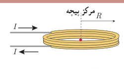
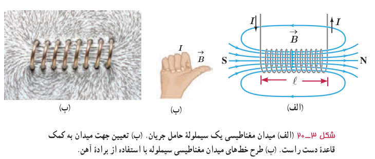

### مثال ۳ـ۳

از پیچۀ مسطحی به شعاع ۶/۲۸ cm که از ۲۰۰ دور سیم نازک درست شده است، جریان ۲۰ mA می‌گذرد (شکل روبه‌رو). اندازۀ میدان مغناطیسی را در مرکز پیچه به‌دست آورید.

**پاسخ:** با توجه به داده‌های مسئله داریم:

$$R=6/28\times10^{-2}\,\mathrm m,\quad N=200,\quad I=20\times10^{-3}\,\mathrm A,\quad B=?$$

با جایگذاری داده‌ها در رابطۀ ۳ـ۵ داریم:

$$B=\frac{\mu_0NI}{2R}=\frac{(4\pi\times10^{-7}\,\mathrm{T.m/A})(200)(20\times10^{-3}\,\mathrm A)}{2(6/28\times10^{-2}\,\mathrm m)}=4/0\times10^{-5}\,\mathrm T=0/40\,\mathrm G$$

### تمرین ۳ـ۴

اندازۀ میدان مغناطیسی دور سر انسان حدود $3\times10^{-8}\,\mathrm G$ اندازه‌گیری شده است. اگرچه جریان‌هایی که این میدان را به‌وجود می‌آورند بسیار پیچیده‌اند، ولی با در نظر گرفتن این جریان‌ها به‌صورت تک‌حلقه‌ای دایره‌ای به قطر ۱۶ cm (پهنای یک سر نوعی) می‌توان بزرگی جریان الکتریکی را تخمین زد. جریان لازم برای ایجاد این میدان در مرکز حلقه چقدر است؟

**میدان مغناطیسی حاصل از سیم‌لولۀ حامل جریان:** سیم‌لوله، سیم درازی است که به‌صورت مارپیچی بلند، پیچیده شده است. با عبور جریان الکتریکی از سیم‌لوله، در فضای اطراف آن میدان مغناطیسی به‌وجود می‌آید. طرح خط‌های میدان مغناطیسی یک سیم‌لولۀ حامل جریان الکتریکی در شکل ۳ـ۲۰ الف و پ نشان داده شده است. همان‌گونه که دیده می‌شود، خط‌های میدان داخل سیم‌لوله بسیار متراکم‌تر از خط‌های میدان در خارج آن است و این نشانگر بزرگ‌تر بودن میدان در داخل سیم‌لوله است. افزون بر این، خط‌های میدان در داخل سیم‌لوله، به‌ویژه در نقطه‌های نسبتاً دور از لبه‌های آن تقریباً موازی و هم‌فاصله‌اند و این، نشانگر یکنواخت بودن میدان مغناطیسی درون سیم‌لوله است. جهت میدان مغناطیسی سیم‌لوله، به کمک قاعدۀ دست راست که در شکل نشان داده شده است تعیین می‌شود (شکل ۳ـ۲۰ ب).

شکل ۳ـ۲۰ الف) میدان مغناطیسی یک سیم‌لولۀ حامل جریان. ب) تعیین جهت میدان به کمک قاعدۀ دست راست. پ) طرح خط‌های میدان مغناطیسی سیم‌لوله با استفاده از برادۀ آهن.
