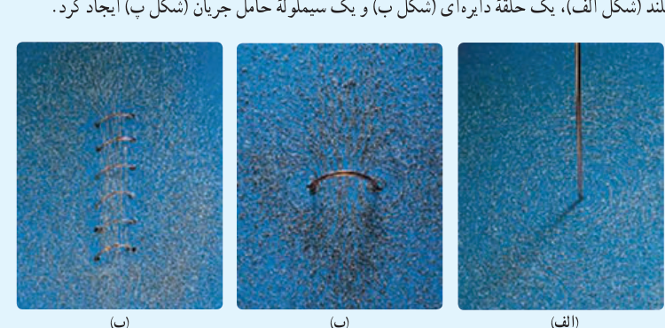

اگر قطر حلقه‌های سیم‌لوله در مقایسه با طول آن، بسیار کوچک و حلقه‌های آن، خیلی به هم نزدیک باشند، به این سیم‌لوله، **سیم‌لولۀ آرمانی** گفته می‌شود. میدان مغناطیسی داخل یک سیم‌لولۀ آرمانی در نقطه‌های دور از لبه‌ها یکنواخت است و اندازۀ آن از رابطۀ زیر به‌دست می‌آید:

$$B=\frac{\mu_0NI}{\ell}\qquad(\text{سیم‌لولۀ آرمانی})\tag{3-6}$$

در این رابطه، $I$ جریان عبوری، $\ell$ طول سیم‌لوله و $N$ تعداد دورهای سیم‌لوله است.

### مثال ۳ـ۴

سیم‌لوله‌ای آرمانی به طول ۱۵ cm دارای ۶۰۰ حلقۀ سیم نزدیک به هم است. اگر جریان ۸۰۰ mA از سیم‌لوله بگذرد، بزرگی میدان مغناطیسی را در نقطه‌ای درون سیم‌لوله و دور از لبه‌های آن پیدا کنید.

**پاسخ:** با توجه به داده‌های مسئله داریم:

$$\ell=15\,\mathrm{cm}=0/15\,\mathrm m,\quad N=600,\quad I=800\,\mathrm{mA}=800\times10^{-3}\,\mathrm A,\quad B=?$$

به این ترتیب داریم:

$$B=\frac{\mu_0NI}{\ell}=\frac{(4\pi\times10^{-7}\,\mathrm{T.m/A})(600)(800\times10^{-3}\,\mathrm A)}{0/15\,\mathrm m}\approx4/0\times10^{-3}\,\mathrm T=40\,\mathrm G$$

### تمرین ۳ـ۵

سیم‌لوله‌ای آرمانی به طول ۴۰/۰ cm چنان طراحی شده است که جریان بیشینه‌ای به‌شدت ۱/۲ A می‌تواند از آن بگذرد. با عبور این جریان از سیم‌لوله، اندازۀ میدان مغناطیسی درون آن و دور از لبه‌ها ۲۷۰ G می‌شود. تعداد دورهای سیم‌لوله چقدر باید باشد؟

### فعالیت ۳ـ۵

آزمایشی را طراحی و اجرا کنید که به کمک آن بتوان با استفاده از برادۀ آهن، طرح خط‌های میدان مغناطیسی را در اطراف یک سیم بلند (شکل الف)، یک حلقۀ دایره‌ای (شکل ب) و یک سیم‌لولۀ حامل جریان (شکل پ) ایجاد کرد.

