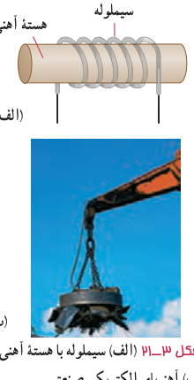
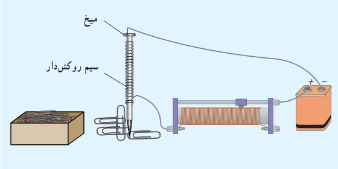

**سیم‌لوله با هستۀ آهنی ـ آهن‌ربای الکتریکی:** شکل ۳ـ۲۱ الف سیم‌لوله‌ای با یک هستۀ آهنی را نشان می‌دهد. وقتی جریانی در سیم‌لوله برقرار می‌شود، میدان مغناطیسی سیم‌لوله، در هستۀ آهنی خاصیت مغناطیسی القا می‌کند و هستۀ آهنی، آهن‌ربا می‌شود. این آهن‌ربا را آهن‌ربای الکتریکی می‌نامند. آهن‌ربای الکتریکی صنعتی (شکل ۳ـ۲۱ ب) شامل پیچه‌ای حامل جریان است که تعداد دور سیم زیادی دارد و میدان مغناطیسی حاصل از آن قادر است مقدار زیادی میله‌های فولادی و دیگر قراضه‌های آهن را بلند کند. هرچه تعداد دورهای سیم‌لوله و جریانی که از آن می‌گذرد بیشتر باشد، آهن‌ربای الکتریکی قوی‌تر خواهد بود. وجود هستۀ آهنی باعث تقویت میدان مغناطیسی سیم‌لوله می‌شود. میدان مغناطیسی سیم‌لولۀ بدون هستۀ آهنی به قدری ضعیف است که در عمل کاربردهای کمی دارد.

میدان مغناطیسی درون سیم‌لوله در حالتی که سیم‌لوله دارای هستۀ آهنی باشد، ممکن است ۱۰۰ تا چند هزار برابر بزرگ‌تر از حالتی باشد که سیم‌لوله بدون هسته است.

شکل ۳ـ۲۱ الف) سیم‌لوله با هستۀ آهنی. ب) آهن‌ربای الکتریکی صنعتی.

### فعالیت ۳ـ۶

قسمتی از سیم نازک روکش‌داری را دور میخ آهنی نسبتاً بلندی بپیچید و مداری مطابق شکل تشکیل دهید. با تغییر مقاومت رئوستا، جریان عبوری از مدار را تغییر دهید. الف) بررسی کنید برای جریان‌های متفاوت، آهن‌ربای الکتریکی چه تعداد گیرۀ آهنی را می‌تواند بلند کند. ب) اگر تعداد دورهای سیم دو برابر شود، نتیجۀ کار چه تفاوتی خواهد داشت؟

## ۳ـ۶ ویژگی‌های مغناطیسی مواد

رفتار آهن‌رباهای دائمی، نوارهای مغناطیسی پشت کارت‌های بانکی و دیسک‌های رایانه‌ای به‌طور مستقیم به ویژگی‌های مغناطیسی مواد بستگی دارد. هنگامی که اطلاعاتی روی نوار مغناطیسی پشت کارت‌های بانکی یا یک دیسک رایانه‌ای ذخیره می‌شود آرایه‌ای از هزاران هزار آهن‌ربای دائمی میکروسکوپی روی نوار مغناطیسی پشت کارت یا دیسک ایجاد می‌شود. در این بخش، برخی ویژگی‌های مغناطیسی مواد را بررسی می‌کنیم.

موادی را که اتم‌ها یا مولکول‌های سازندۀ آنها خاصیت مغناطیسی داشته باشند، مواد مغناطیسی می‌نامند. در واقع می‌توان گفت کوچک‌ترین ذره‌های تشکیل‌دهندۀ این مواد (اتم‌ها یا مولکول‌ها) مانند دوقطبی مغناطیسی رفتار می‌کنند. در این کتاب، دوقطبی‌های مغناطیسی را با یک پیکان کوچک نشان داده‌ایم که می‌توانند جهت‌گیری‌های متفاوتی داشته باشند و هرکدام از آنها وابسته به یک اتم یا مولکول‌اند. در ادامه به بررسی برخی از مواد مغناطیسی می‌پردازیم که می‌توان خواص آنها را با دوقطبی‌های مغناطیسی توضیح داد.
