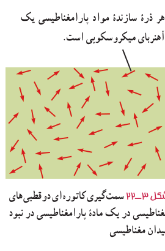
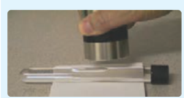

**مواد پارامغناطیسی:** اتم‌های مواد پارامغناطیسی، خاصیت مغناطیسی دارند اما دوقطبی‌های مغناطیسی وابسته به آنها، به‌طور کاتوره‌ای سمت‌گیری کرده‌اند و میدان مغناطیسی خالصی ایجاد نمی‌کنند (شکل ۳ـ۲۲). با قرار دادن مواد پارامغناطیسی درون میدان مغناطیسی خارجی قوی (مثلاً نزدیک یک آهن‌ربای قوی)، دوقطبی‌های مغناطیسی آنها، مانند عقربۀ قطب‌نما در نزدیکی آهن‌ربا رفتار می‌کنند و به مقدار مختصری در راستای خط‌های میدان مغناطیسی منظم می‌شوند. با دور کردن آهن‌ربا از این مواد، دوقطبی‌های مغناطیسی آنها، دوباره به‌طور کاتوره‌ای سمت‌گیری می‌کنند.

به این ترتیب، می‌توان گفت مواد پارامغناطیسی در حضور میدان‌های مغناطیسی قوی، خاصیت مغناطیسی ضعیف و موقت پیدا می‌کنند. اورانیم، پلاتین، آلومینیم، سدیم، اکسیژن و اکسید نیتروژن از جمله مواد پارامغناطیسی‌اند.

شکل ۳ـ۲۲ سمت‌گیری کاتوره‌ای دوقطبی‌های مغناطیسی در یک مادۀ پارامغناطیسی در نبود میدان مغناطیسی.

### فعالیت ۳ـ۷

یک لولۀ آزمایش را تا نزدیکی لبۀ آن از الکل طبی (اتانول ۹۶ درجه) پر کنید. در لوله را ببندید و آن را به‌طور افقی قرار دهید. مطابق شکل، یک آهن‌ربای نئودیمیم را بالای حباب هوای درون لوله بگیرید و به‌آرامی آهن‌ربا را حرکت دهید. دلیل آنچه را مشاهده می‌کنید در گروه خود به گفت‌وگو بگذارید.

**مواد دیامغناطیسی:** اتم‌های مواد دیامغناطیسی، نظیر مس، نقره، سرب و بیسموت، به‌طور ذاتی فاقد خاصیت مغناطیسی‌اند. به عبارت دیگر، هیچ یک از اتم‌های این مواد، دارای دوقطبی مغناطیسی خالصی نیستند. با وجود این، حضور میدان مغناطیسی خارجی، می‌تواند سبب القای دوقطبی‌های مغناطیسی در خلاف سوی میدان خارجی، در مواد دیامغناطیسی شود. در فصل بعد با دلایل این موضوع، با تفصیل بیشتری آشنا خواهید شد. توجه داشته باشید که در فعالیت ۳ـ۷، مولکول‌های اتانول خاصیت دیامغناطیسی دارند و حرکت حباب را می‌توان بر این اساس توضیح داد.

**مواد فرومغناطیسی:** نوع دیگری از مواد به نام مواد فرومغناطیسی وجود دارد که اتم‌های آنها به‌طور ذاتی دارای دوقطبی مغناطیسی هستند. آهن، نیکل، کبالت و بسیاری از آلیاژهای دارای این عنصرها فرومغناطیسی‌اند. برهم‌کنش‌های قوی بین دوقطبی‌های مغناطیسی در این مواد موجب می‌شود که این دوقطبی‌ها، حتی در نبود میدان خارجی، در ناحیه‌هایی که حوزه‌های مغناطیسی نامیده می‌شود، همسو شوند. نمونه‌ای از ساختار حوزه‌ها در مواد فرومغناطیسی در شکل ۳ـ۲۳ الف نشان داده شده است. درون هر حوزه تقریباً از مرتبۀ $10^{11}$ اتم وجود دارد که دوقطبی‌های مغناطیسی وابسته به آنها هم‌جهت‌اند.

مواد فرومغناطیسی را می‌توان با قرار دادن در یک میدان مغناطیسی، آهن‌ربا کرد. اثر میدان مغناطیسی خارجی بر حوزه‌های مغناطیسی باعث می‌شود که دوقطبی‌های مغناطیسی هر حوزه تحت تأثیر میدان مغناطیسی قرار گیرند و جهت آنها به جهت میدان خارجی متمایل شود. به این ترتیب، حوزه‌هایی که نسبت به میدان همسو هستند، رشد می‌کنند و حجمشان زیاد می‌شود. از سوی دیگر حجم حوزه‌هایی
