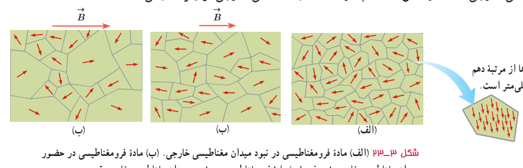
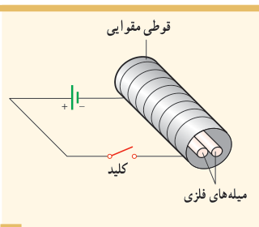

که سمت‌گیری آنها در راستای میدان نیست، کم می‌شود. در این فرایند، مرز بین بیشتر حوزه‌ها جابه‌جا می‌شود، و ماده خاصیت آهن‌ربایی پیدا می‌کند. شکل ۳ـ۲۳ ب یک مادۀ فرومغناطیسی را در یک میدان مغناطیسی خارجی ضعیف و شکل ۳ـ۲۳ پ در یک میدان مغناطیسی خارجی قوی‌تر نشان می‌دهد.

شکل ۳ـ۲۳ الف) مادۀ فرومغناطیسی در نبود میدان مغناطیسی خارجی. ب) مادۀ فرومغناطیسی در حضور میدان مغناطیسی خارجی ضعیف. پ) مادۀ فرومغناطیسی در حضور میدان مغناطیسی خارجی قوی.

حوزه‌های مغناطیسی برخی از مواد فرومغناطیسی، در حضور میدان مغناطیسی خارجی به سهولت تغییر می‌کند و ماده به‌سادگی آهن‌ربا می‌شود و با حذف میدان خارجی نیز، خاصیت آهن‌ربایی خود را به‌آسانی از دست می‌دهد. این مواد را مواد **فرومغناطیسی نرم** می‌نامند. آهن نرم¹ و فولاد کم‌کربن² مثال‌هایی از این دسته مواد هستند. از این مواد در ساخت هستۀ پیچه‌ها و سیم‌لوله‌ها استفاده می‌شود. مواد فرومغناطیسی نرم برای ساختن آهن‌رباهای الکتریکی (آهن‌رباهای غیردائم) نیز مناسب‌اند (چرا؟).

برخی مواد دیگر مانند فولاد (آهن به اضافۀ ۲ درصد کربن)، آلیاژهای آهن، کبالت و نیکل به سختی آهن‌ربا می‌شوند؛ یعنی در حضور میدان مغناطیسی خارجی، حجم حوزه‌ها در آنها به سختی تغییر می‌کند. این مواد را مواد **فرومغناطیسی سخت** می‌نامند. در این مواد، سمت‌گیری دوقطبی‌های مغناطیسی حوزه‌ها پس از حذف میدان خارجی، تا مدت زمان زیادی، تقریباً بدون تغییر باقی می‌ماند. به‌عبارت دیگر، پس از حذف میدان خارجی، مادۀ فرومغناطیسی سخت، خاصیت آهن‌ربایی خود را تا اندازۀ قابل توجهی حفظ می‌کند. به همین دلیل، این مواد برای ساختن آهن‌رباهای دائمی مناسب‌اند.

برای خاصیت آهن‌ربایی هر مادۀ فرومغناطیسی، مقدار اشباع یا بیشینه‌ای وجود دارد. این وضعیت هنگامی به‌وجود می‌آید که مادۀ فرومغناطیسی در یک میدان مغناطیسی بسیار قوی قرار گیرد؛ به‌طوری که درصد بالایی از دوقطبی‌های مغناطیسی حوزه‌ها به موازات یکدیگر هم‌خط شوند. به عبارت دیگر، حجم حوزه‌هایی که با میدان مغناطیسی خارجی همسو هستند، به بیشترین مقدار خود برسد.

### پرسش ۳ـ۹

دو میلۀ فلزی بلند مطابق شکل روبه‌رو درون سیم‌لوله‌ای که دور یک قوطی مقوایی پیچیده شده است قرار دارند. با بستن کلید و عبور جریان از این سیم‌لوله، مشاهده می‌شود که دو میله از یکدیگر دور می‌شوند. وقتی کلید باز و جریان در مدار قطع می‌شود، میله‌ها به محل اولیۀ باز می‌گردند. الف) چرا با عبور جریان از پیچه، میله‌ها از یکدیگر دور می‌شوند؟ ب) با دلیل توضیح دهید میله‌های فلزی از نظر مغناطیسی در کدام دسته قرار می‌گیرند.

۱ـ نرم در عبارت آهن نرم به معنای نرم بودن مکانیکی نیست، بلکه به این معنی است که هم به‌آسانی خاصیت مغناطیسی پیدا می‌کند و هم به‌آسانی این خاصیت را از دست می‌دهد.  
۲ـ فولاد کم‌کربن، آلیاژی از آهن و حدود ۰/۰۵٪ تا ۰/۲۵٪ کربن و همچنین عناصر دیگری مانند منگنز یا سیلیسیم است.
