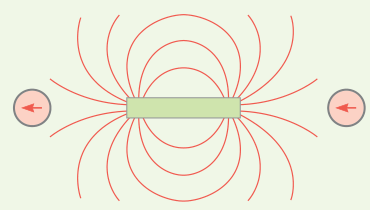
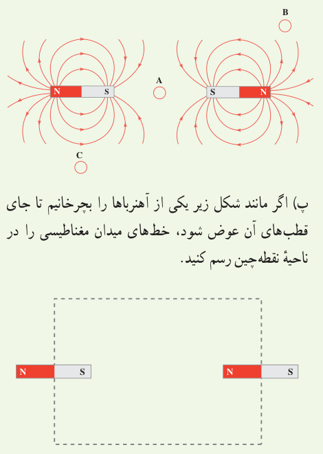
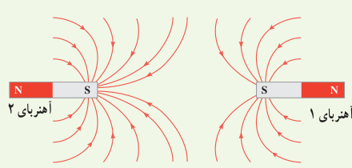
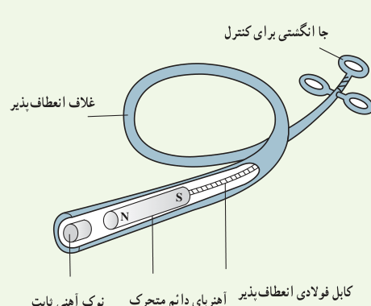

# پرسش‌ها و مسئله‌های فصل ۳

## ۳ـ۱ و ۳ـ۲ مغناطیس و قطب‌های مغناطیسی و میدان مغناطیسی

**۱** با توجه به جهت‌گیری عقربه‌های مغناطیسی در شکل زیر، قطب‌های آهن‌ربای میله‌ای و جهت خط‌های میدان مغناطیسی را تعیین کنید.

**۲** شکل زیر، خط‌های میدان مغناطیسی را در نزدیکی دو آهن‌ربای میله‌ای یکسان نشان می‌دهد. الف) دربارۀ میدان مغناطیسی در نقطۀ A چه می‌توان گفت؟ ب) با رسم شکل نشان دهید عقربۀ قطب‌نما در نقطه‌های B و C به ترتیب در کدام جهت قرار می‌گیرد؟ پ) اگر مانند شکل زیر یکی از آهن‌رباها را بچرخانیم تا جای قطب‌های آن عوض شود، خط‌های میدان مغناطیسی را در ناحیۀ نقطه‌چین رسم کنید.

**۳** الف) آهن‌ربای میله‌ای با قطب‌های نامشخص در اختیار داریم. دست کم دو روش را برای تعیین قطب‌های این آهن‌ربا بیان کنید. ب) خط‌های میدان مغناطیسی بین دو آهن‌ربا در شکل زیر نشان داده شده است. اندازۀ میدان مغناطیسی را در نزدیکی قطب‌های آهن‌رباها با هم مقایسه کنید.

**۴** کودکی یک قطعۀ کوچک آهنی را بلعیده است. پزشک می‌خواهد آن را با دستگاه شکل زیر بیرون بیاورد. الف) هنگامی که آهن‌ربای دائمی به نوک ثابت آهنی نزدیک می‌شود چه اتفاقی می‌افتد؟ ب) ساختن نوک ثابت آهنی چه مزیتی دارد؟ پ) این وسیله را باید به درون گلوی کودک وارد و به سوی فلز بلعیده‌شده هدایت کرد؛ چرا غلاف باید انعطاف‌پذیر باشد؟ ت) پزشک می‌خواهد یک گیرۀ آهنی کاغذ و یک واشر آلومینیومی را از گلوی کودک بیرون بیاورد؛ کدام‌یک را می‌توان بیرون آورد؟ چرا؟

