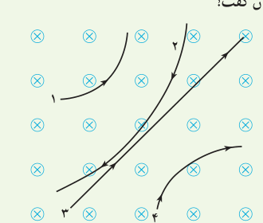
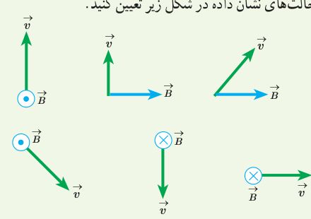
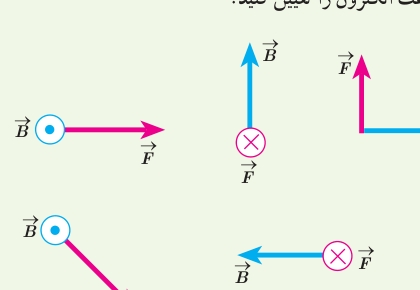
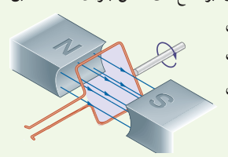
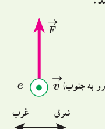
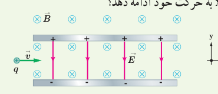

## ۳ـ۳ نیروی مغناطیسی وارد بر ذرۀ باردار متحرک در میدان مغناطیسی

**۵** چهار ذره هنگام عبور از میدان مغناطیسی درون‌سو مسیرهایی مطابق شکل زیر می‌پیمایند. دربارۀ نوع بار هر ذره چه می‌توان گفت؟

**۶** جهت نیروی مغناطیسی وارد بر بار مثبت را در هر یک از حالت‌های نشان داده شده در شکل زیر تعیین کنید.

**۷** نیروی مغناطیسی $\vec F$ وارد بر الکترونی که در میدان مغناطیسی $\vec B$ در حرکت است، در شکل زیر، نشان داده شده است. فرض کنید راستای حرکت الکترون بر میدان مغناطیسی عمود است؛ در هر یک از حالت‌های نشان داده شده جهت سرعت الکترون را تعیین کنید.

**۸** حلقۀ رسانای مستطیل شکلی که حامل جریان $I$ است، بر اثر نیروی مغناطیسی وارد بر ضلع‌های حامل جریان حلقه، مطابق شکل درون میدان مغناطیسی یکنواخت می‌چرخد. جهت جریان را در حلقه تعیین کنید.

**۹** پروتونی با تندی $4/4\times10^6\,\mathrm{m/s}$ درون میدان مغناطیسی یکنواختی به‌اندازۀ ۱۸ mT در حرکت است. جهت حرکت پروتون با جهت $\vec B$ زاویۀ ۶۰° می‌سازد. الف) اندازۀ نیروی وارد بر این پروتون را محاسبه کنید. ب) اگر تنها این نیرو بر پروتون وارد شود، شتاب پروتون را حساب کنید. (بار الکتریکی پروتون $1/6\times10^{-19}\,\mathrm C$ و جرم آن $1/7\times10^{-27}\,\mathrm{kg}$ را در نظر بگیرید.)

**۱۰** الکترونی با تندی $2/4\times10^5\,\mathrm{m/s}$ درون میدان مغناطیسی یکنواختی در حرکت است. اندازۀ نیرویی که از طرف میدان مغناطیسی بر این الکترون وارد می‌شود، هنگامی بیشینه است که الکترون به سمت جنوب حرکت کند. الف) اگر جهت این نیروی بیشینه، رو به بالا و اندازۀ آن برابر $6/8\times10^{-14}\,\mathrm N$ باشد، اندازه و جهت میدان مغناطیسی را تعیین کنید. ب) اندازۀ میدان الکتریکی چقدر باشد تا همین نیرو را ایجاد کند؟

**۱۱** ذرۀ باردار مثبتی با جرم ناچیز و با سرعت $\vec v$ در امتداد محور x وارد فضایی می‌شود که میدان‌های یکنواخت $\vec E$ و $\vec B$ وجود دارد (شکل زیر). اندازۀ این میدان‌ها برابر $E=450\,\mathrm{N/C}$ و $B=0/18\,\mathrm T$ است. تندی ذره چقدر باشد تا در همان امتداد محور x به حرکت خود ادامه دهد؟

