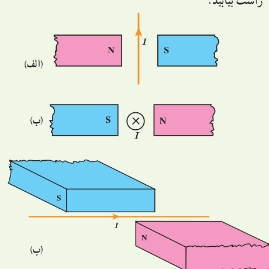
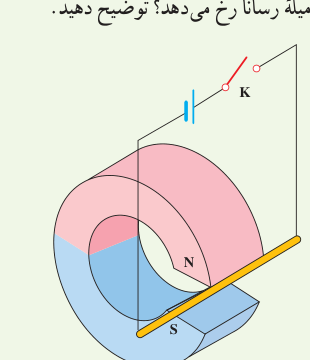
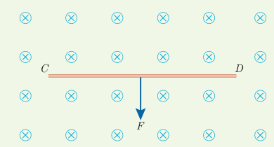
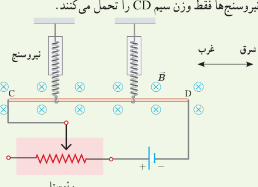
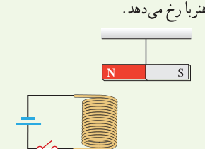

## ۳ـ۴ نیروی مغناطیسی وارد بر سیم حامل جریان

**۱۲** جهت نیروی مغناطیسی وارد بر سیم حامل جریان را در هر یک از شکل‌های الف، ب و پ با استفاده از قاعدۀ دست راست بیابید.

**۱۳** یک میلۀ رسانا به پایانه‌های یک باتری وصل شده و مطابق شکل در فضای بین قطب‌های یک آهن‌ربای C شکل آویزان شده است و می‌تواند آزادانه نوسان کند. با بستن کلید K، چه اتفاقی برای میلۀ رسانا رخ می‌دهد؟ توضیح دهید.

**۱۴** سیم رسانای CD به طول ۲ m مطابق شکل زیر عمود بر میدان مغناطیسی درون‌سو با اندازۀ ۰/۵ T قرار گرفته است؛ اگر اندازۀ نیروی مغناطیسی وارد بر سیم برابر ۱ N باشد، جهت و مقدار جریان عبوری از سیم را تعیین کنید.

**۱۵** یک سیم حامل جریان ۱/۰ A مطابق شکل زیر با دو نیروسنج فنری که به دو انتهای آن بسته شده‌اند، به‌طور افقی و در راستای غرب ـ شرق قرار دارد. میدان مغناطیسی یکنواختی به‌طرف شمال و اندازۀ ۰/۰۵۰ T ایجاد می‌کنیم. الف) اندازۀ نیروی مغناطیسی وارد بر ۲۰ سانتی‌متر این سیم را پیدا کنید. ب) اگر بخواهیم نیروسنج‌ها عدد صفر را نشان دهند، چه جریانی و در چه جهتی باید از سیم عبور کند؟ جرم هر متر از طول این سیم ۸ گرم است ($g=9/8\,\mathrm{N/kg}$). فرض کنید نیروسنج‌ها فقط وزن سیم CD را تحمل می‌کنند.

## ۳ـ۵ میدان مغناطیسی حاصل از جریان الکتریکی

**۱۶** یک آهن‌ربای میله‌ای مطابق شکل زیر، بالای سیم‌لوله‌ای آویزان شده است. توضیح دهید با بستن کلید K چه تغییری در وضعیت آهن‌ربا رخ می‌دهد.

