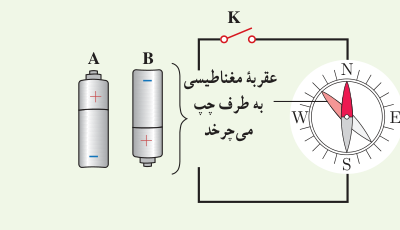
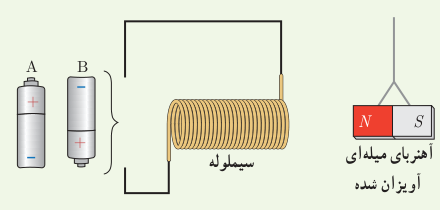
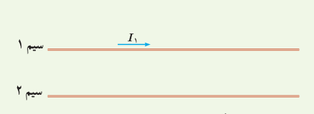
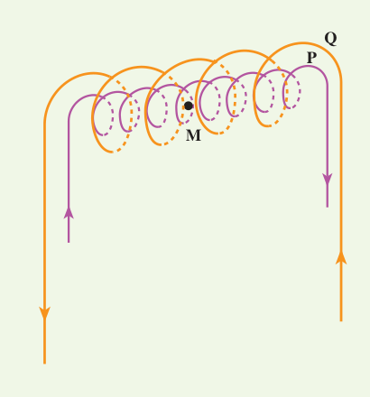
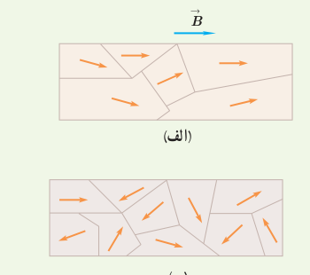

**۱۷** کدام باتری را در مدار شکل زیر قرار دهیم تا پس از بستن کلید K، عقربۀ قطب‌نما که روی سیم قرار دارد، در خلاف جهت حرکت عقربه‌های ساعت شروع به چرخش کند؟ دلیل انتخاب خود را توضیح دهید.

**۱۸** کدام باتری را در مدار شکل زیر قرار دهیم تا آهن‌ربای میله‌ای آویزان شده به طرف سیم‌لوله جذب شود؟ دلیل انتخاب خود را توضیح دهید.

**۱۹** شکل زیر، دو سیم موازی و بلند حامل جریان را نشان می‌دهد. اگر میدان مغناطیسی برآیند حاصل از این سیم‌ها در نقطۀ A صفر باشد، جهت جریان آن را در سیم ۲ پیدا کنید.

**۲۰** سیم‌لوله‌ای شامل ۲۵۰ حلقه است که دور یک لولۀ پلاستیکی توخالی به طول ۰/۱۴ متر پیچیده شده است. اگر جریان گذرنده از سیم‌لوله ۰/۸ A باشد، اندازۀ میدان مغناطیسی درون سیم‌لوله را حساب کنید.

**۲۱** در شکل زیر دو سیم‌لولۀ P و Q هم‌محورند و طول برابر دارند. تعداد دور سیم‌لولۀ P برابر ۲۰۰ و تعداد دور سیم‌لولۀ Q برابر ۳۰۰ است. اگر جریان ۱ A از سیم‌لولۀ Q عبور کند، از سیم‌لولۀ P چه جریانی باید عبور کند تا برآیند میدان مغناطیسی ناشی از دو سیم‌لوله در نقطۀ M (روی محور دو سیم‌لوله) صفر شود؟

## ۳ـ۶ ویژگی‌های مغناطیسی مواد

**۲۲** شکل الف حوزه‌های مغناطیسی مادۀ فرومغناطیسی را درون میدان خارجی $\vec B$ نشان می‌دهد. شکل ب همان ماده را پس از حذف میدان $\vec B$ نشان می‌دهد. نوع مادۀ فرومغناطیسی را با ذکر دلیل تعیین کنید.

