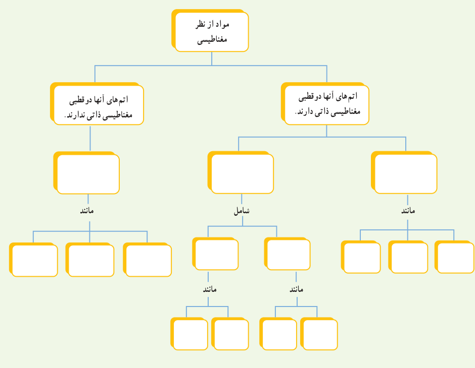

**۲۳** با توجه به آنچه در بخش ویژگی‌های مغناطیسی مواد دیدید، نقشۀ مفهومی زیر را کامل کنید.

مواد از نظر مغناطیسی: اتم‌های آنها دوقطبی مغناطیسی ذاتی دارند / اتم‌های آنها دوقطبی مغناطیسی ذاتی ندارند. خانه‌های دسته‌ها و مثال‌ها خالی‌اند.
