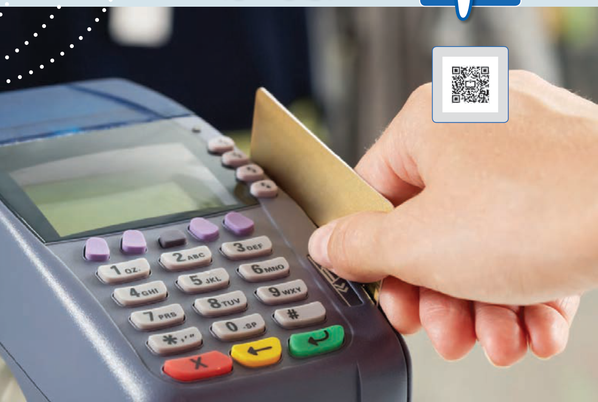

# فصل ۴: القای الکترومغناطیسی و جریان متناوب

وقتی کارت بانکی درون دستگاه کارت‌خوان «کشیده» می‌شود، اطلاعات رمزینۀ ذخیره‌شده در نوار مغناطیسی پشت کارت، به مرکز اطلاعات بانک ارسال می‌شود. چرا به جای ثابت نگه داشتن کارت در شکاف دستگاه کارت‌خوان، لازم است آن را بکشیم؟ پاسخ در همین فصل.
