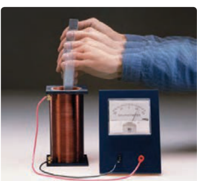
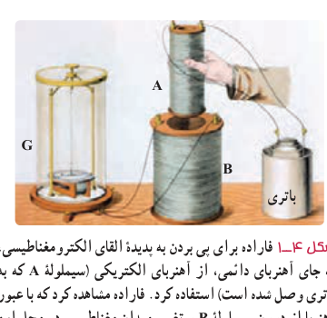

در فصل قبل، با آثار مغناطیسی جریان الکتریکی آشنا شدید که در سال ۱۸۲۰ میلادی توسط اورستد کشف شد. در سال ۱۸۳۱ فاراده پس از آزمایش‌های فراوان، مشاهده کرد که عبور آهن‌ربا از یک پیچه، سبب برقراری جریان الکتریکی در پیچه می‌شود. این اثر که امروزه به قانون القای الکترومغناطیسی فاراده شناخته می‌شود، اساس کار مولدها برای تولید جریان الکتریکی است. در این فصل، پس از آشنایی با این قانون، به چگونگی تولید جریان متناوب خواهیم پرداخت.

## ۴ـ۱ پدیدۀ القای الکترومغناطیسی

در این بخش، به بررسی القای نیروی محرکۀ الکتریکی در یک مدار بسته خواهیم پرداخت. این پدیده را القای الکترومغناطیسی می‌نامند. با انجام آزمایش زیر با این پدیده بیشتر آشنا می‌شوید.

## آزمایش ۴ـ۱

**هدف: بررسی پدیدۀ القای الکترومغناطیسی**

**وسیله‌های مورد نیاز:** گالوانومتر، آهن‌ربای میله‌ای، سیم‌لوله یا پیچه و سیم رابط

**شرح آزمایش:**

• دو سر سیم‌لوله را به گالوانومتر ببندید.

• یکی از قطب‌های آهن‌ربا را وارد سیم‌لوله کنید (شکل روبه‌رو). مشاهدات خود را هنگام انجام این کار، یادداشت کنید.

• اکنون آهن‌ربا را از سیم‌لوله خارج کنید. مشاهدات خود را هنگام انجام این کار، دوباره یادداشت کنید.

• مراحل بالا را برای قطب دیگر آهن‌ربا تکرار کنید.

• آزمایش را در حالی انجام دهید که آهن‌ربا ثابت باشد و سیم‌لوله به آن نزدیک یا از آن دور شود. آیا نتیجۀ آزمایش تغییری می‌کند؟ توضیح دهید.

در سال ۱۸۳۱ میلادی مایکل فاراده دانشمند انگلیسی و تقریباً هم‌زمان با او جوزف هانری دانشمند امریکایی، با انجام آزمایش‌هایی مشابه آزمایش ۴ـ۱ دریافتند که هنگام دور و نزدیک کردن آهن‌ربا به پیچه، عقربۀ گالوانومتر منحرف می‌شود و عبور جریانی را از مدار نشان می‌دهد؛ درست مانند وقتی که در مدار، باتری وجود دارد (شکل ۴ـ۱). این پدیده را القای الکترومغناطیسی و جریان تولید شده را جریان الکتریکی القایی می‌نامند.

شکل ۴ـ۱ فاراده برای پی بردن به پدیدۀ القای الکترومغناطیسی، به جای آهن‌ربای دائمی، از آهن‌ربای الکتریکی (سیم‌لولۀ A که به باتری وصل شده است) استفاده کرد. فاراده مشاهده کرد که با عبور آهن‌ربا از درون سیم‌لولۀ B و تغییر میدان مغناطیسی در محل این سیم‌لوله، عقربۀ گالوانومتر منحرف می‌شود.
