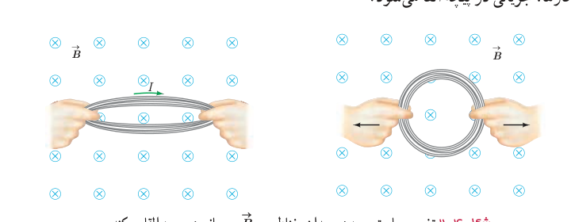
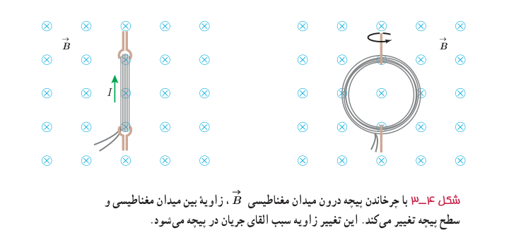
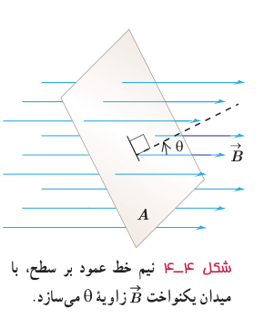

پیش از این دیدیم که با تغییر اندازۀ میدان در محل سیم‌لوله، جریان در آن القا می‌شود. به جز این روش، به روش‌های دیگری نیز می‌توان در پیچه یا سیم‌لوله، جریان الکتریکی القا کرد. اگر مساحت پیچه‌ای انعطاف‌پذیر را درون میدان مغناطیسی یکنواخت $\vec B$ تغییر دهیم (شکل ۴ـ۲) یا پیچه‌ای را درون میدان مغناطیسی یکنواخت $\vec B$ بچرخانیم (شکل ۴ـ۳)، مشاهده می‌شود که در هنگام انجام این کارها، جریانی در پیچه القا می‌شود.

شکل ۴ـ۲ تغییر مساحت پیچه در میدان مغناطیسی $\vec B$، جریانی در پیچه القا می‌کند.

شکل ۴ـ۳ با چرخاندن پیچه درون میدان مغناطیسی $\vec B$، زاویه بین میدان مغناطیسی و سطح پیچه تغییر می‌کند. این تغییر زاویه سبب القای جریان در پیچه می‌شود.

## ۴ـ۲ قانون القای الکترومغناطیسی فاراده

پیش از این دیدیم که به دلایلی مانند تغییر میدان مغناطیسی در محل یک پیچه، تغییر مساحت پیچه در حضور میدان مغناطیسی یا چرخش پیچه درون میدان مغناطیسی، جریان الکتریکی در آن القا می‌شود. عامل اساسی و مشترک در ایجاد جریان القایی در همۀ این آزمایش‌ها، **تغییر شار مغناطیسی** عبوری از پیچه است.

شار مغناطیسی، کمیتی نرده‌ای است و برای میدان مغناطیسی یکنواخت $\vec B$ که از پیچه‌ای با مساحت معین $A$ می‌گذرد به صورت زیر تعریف می‌شود:

$$\Phi=BA\cos\theta\tag{4-1}$$

همان‌طور که در شکل ۴ـ۴ دیده می‌شود: $\theta$ زاویۀ بین بردار میدان مغناطیسی و نیم‌خط عمود بر سطح حلقه است (این نیم‌خط را به‌طور خط‌چین روی شکل نشان داده‌ایم).

شکل ۴ـ۴ نیم‌خط عمود بر سطح، با میدان یکنواخت $\vec B$ زاویۀ $\theta$ می‌سازد.

یکای SI شار مغناطیسی، وبر (Wb) است که با توجه به رابطۀ ۴ـ۱ داریم: $1\,\mathrm{Wb}=1\,\mathrm T\times1\,\mathrm{m^2}$.

### مایکل فاراده (۱۷۹۱–۱۸۶۷)

مایکل فاراده، پسر یک آهنگر انگلیسی بود. به گفتۀ خود او: «تحصیلات من بسیار معمولی بود. خواندن را کمی بیشتر از حد مقدماتی و نوشتن و ریاضیات را در حد شاگرد یک مدرسۀ روزانه می‌دانستم. ساعت‌های خارج از مدرسه من در خانه و خیابان‌ها می‌گذشت.» وی در سن ۱۲ سالگی به‌عنوان شاگرد در یک کتاب‌فروشی مشغول به کار شد. فاراده ۱۹ ساله بود که به او اجازه داده شد تا در جلسۀ سخنرانی سر همفری دیوی، شیمی‌دان مشهور (۱۷۷۸–۱۸۲۹)، که در مؤسسۀ سلطنتی لندن برگزار می‌شد، حضور یابد. مؤسسۀ سلطنتی یک مرکز مهم پژوهش و آموزش علوم بود. فاراده به‌شدت علاقه‌مند علوم شد و پیش خود به تحصیل علم شیمی پرداخت. در سال ۱۸۱۳ تقاضای شغلی در مؤسسۀ سلطنتی کرد و دیوی او را به عنوان یک همکار در امور پژوهشی استخدام کرد. فاراده به‌زودی نبوغ خود را به عنوان یک آزمایشگر نشان داد. وی مقاله‌های مهمی در شیمی، خواص مغناطیسی، الکتریسیته و نور نوشت و سرانجام به عنوان رئیس مؤسسۀ سلطنتی برگزیده شد. فاراده را به سبب کشف‌های بسیارش یکی از بزرگ‌ترین دانشمندان تجربی عصر خود می‌دانند.
