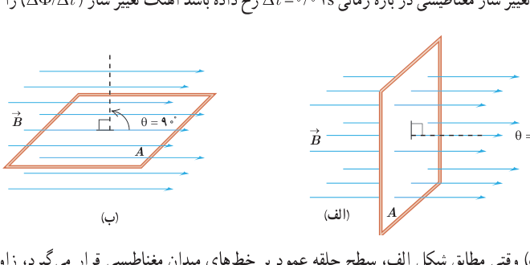

**توجه:** همواره دو جهت برای رسم نیم‌خط عمود بر یک سطح معین وجود دارد. علامت شار مغناطیسی عبوری از این سطح نیز به انتخاب این جهت بستگی دارد. برای مثال، در شکل ۴ـ۴، نیم‌خط عمود را در طرفی از سطح رسم کرده‌ایم که زاویۀ بین آن و جهت میدان $\vec B$ کمتر از ۹۰° است و در نتیجه شار عبوری از سطح مثبت می‌شود. اگر نیم‌خط عمود را در طرف دیگر سطح انتخاب کنیم، در این صورت، زاویۀ آن با جهت میدان $\vec B$ بیشتر از ۹۰° خواهد شد و شار عبوری از سطح منفی می‌شود. هر دو انتخاب به یک اندازه مفیدند، ولی در حل یک مسئله، همواره باید یکی را انتخاب کنیم و تا پایان آن را تغییر ندهیم.

### مثال ۴ـ۱

الف) مطابق شکل الف، سطح حلقۀ رسانایی، به شکل مربع با ضلع ۲۰ cm، عمود بر میدان مغناطیسی یکنواختی به بزرگی ۲۵۰ G قرار دارد. شار عبوری از این حلقه را به‌دست آورید.

ب) اگر حلقه را بچرخانیم به طوری که سطح حلقه موازی با خط‌های میدان مغناطیسی شود، شار مغناطیسی عبوری از آن چقدر می‌شود؟

پ) تغییر شار مغناطیسی عبوری از حلقه را وقتی از موقعیت شکل الف به موقعیت شکل ب می‌چرخد به‌دست آورید.

ت) اگر این تغییر شار مغناطیسی در بازۀ زمانی $\Delta t=0/01\,\mathrm s$ رخ داده باشد آهنگ تغییر شار ($\Delta\Phi/\Delta t$) را پیدا کنید.

**پاسخ:** الف) وقتی مطابق شکل الف، سطح حلقه عمود بر خط‌های میدان مغناطیسی قرار می‌گیرد، زاویۀ بین میدان $\vec B$ و نیم‌خط عمود بر سطح حلقه برابر صفر می‌شود. به این ترتیب، شار عبوری از سطح حلقه برابر است با:

$$A=0/2\,\mathrm m\times0/2\,\mathrm m=0/04\,\mathrm{m^2},\quad B=250\,\mathrm G=2/50\times10^{-2}\,\mathrm T,\quad\theta=0^\circ$$
$$\Phi=BA\cos\theta=(2/50\times10^{-2}\,\mathrm T)(0/04\,\mathrm{m^2})(\cos0^\circ)=1\times10^{-3}\,\mathrm{Wb}=1\,\mathrm{mWb}$$

ب) وقتی مطابق شکل ب، حلقه می‌چرخد و سطح آن موازی با خط‌های میدان مغناطیسی قرار می‌گیرد، زاویۀ بین میدان $\vec B$ و نیم‌خط عمود بر سطح حلقه برابر ۹۰° می‌شود. از آنجا که $\cos90^\circ=0$ است، در این شرایط، هیچ شاری از سطح حلقه عبور نمی‌کند.

پ) همان‌طور که دیدید شار عبوری از سطح حلقه در وضعیت شکل الف و وضعیت شکل ب، به‌ترتیب، برابر $\Phi_1=1\,\mathrm{mWb}$ و $\Phi_2=0$ است. به این ترتیب، تغییر شار عبوری از سطح حلقه برابر $\Delta\Phi=\Phi_2-\Phi_1=-1\,\mathrm{mWb}$ می‌شود. علامت منفی نشان می‌دهد در حین چرخش حلقه از وضعیت شکل الف به وضعیت شکل ب، شار مغناطیسی عبوری از سطح آن کاهش یافته است.

ت) با توجه به نتیجۀ قسمت پ، آهنگ تغییر شار برابر است با:

$$\frac{\Delta\Phi}{\Delta t}=\frac{-1\times10^{-3}\,\mathrm{Wb}}{0/01\,\mathrm s}=-0/1\,\mathrm{Wb/s}$$
