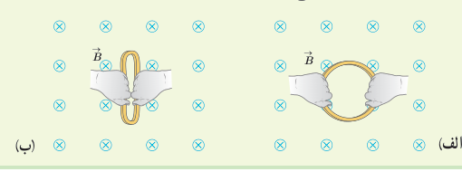

### تمرین ۴ـ۱

الف) حلقه‌ای به مساحت $25\,\mathrm{cm^2}$ درون میدان مغناطیسی یکنواخت درون‌سویی به اندازۀ ۰/۰۳۰ T قرار دارد (شکل الف). شار مغناطیسی عبوری از حلقه را به‌دست آورید.

ب) اگر مطابق شکل ب و بدون تغییر $\vec B$، مساحت سطح حلقه را به $10\,\mathrm{cm^2}$ برسانیم، شار مغناطیسی عبوری از حلقه را در این وضعیت به‌دست آورید.

پ) اگر این تغییر شار در بازۀ زمانی $\Delta t=0/20\,\mathrm s$ رخ داده باشد، آهنگ تغییر شار ($\Delta\Phi/\Delta t$) را پیدا کنید.

### پرسش ۴ـ۱

کدام‌یک از یکاهای زیر معادل یکای وبر بر ثانیه (Wb/s) است؟ □ V/A □ V □ A □ Ω

اکنون که با تعریف و مفهوم شار مغناطیسی آشنا شدید دوباره نگاهی می‌کنیم به پدیدۀ القای الکترومغناطیسی که در بخش قبل بررسی کردیم. همان‌طور که گفتیم عامل مشترک در تمامی پدیده‌هایی که منجر به تولید جریان القایی در مدار می‌شود، تغییر شار مغناطیسی عبوری از پیچه یا سیم‌لوله است. بنابر قانون فاراده، هرگاه شار مغناطیسی‌ای که از مدار بسته‌ای می‌گذرد تغییر کند، نیروی محرکه‌ای در آن القا می‌شود که بزرگی آن با آهنگ تغییر شار مغناطیسی متناسب است؛ یعنی هرچه آهنگ تغییر شار مغناطیسی بیشتر باشد، نیروی محرکۀ القایی و در نتیجه جریان القایی تولید شده در مدار بیشتر خواهد بود. مثلاً در آزمایش‌های مربوط به شکل‌های ۴ـ۱، ۴ـ۲ و ۴ـ۳ هرچه حرکتی که سبب تغییر شار مغناطیسی می‌شود، سریع‌تر انجام شود، عقربۀ گالوانومتر بیشتر منحرف می‌شود، و این نشان می‌دهد که جریان القایی بزرگ‌تری به‌وجود آمده است.

قانون فاراده برای پیچه یا سیم‌لوله‌ای که از $N$ دور مشابه تشکیل شده باشد با رابطۀ زیر بیان می‌شود:

$$\mathcal E_{av}=-N\frac{\Delta\Phi}{\Delta t}\tag{4-2}$$

در این رابطه $\mathcal E_{av}$ نیروی محرکۀ القایی متوسط برحسب ولت و $\Delta\Phi/\Delta t$ آهنگ تغییر شار مغناطیسی برحسب وبر بر ثانیه (Wb/s) است. اگر مقاومت پیچه یا سیم‌لوله برابر $R$ باشد، جریان القایی متوسط در آن از رابطۀ زیر محاسبه می‌شود:

$$I_{av}=\frac{\mathcal E_{av}}R\tag{4-3}$$

همان‌طور که از رابطۀ ۴ـ۳ دیده می‌شود، هرچه مقاومت پیچه یا مداری که در آن شار مغناطیسی تغییر می‌کند، بیشتر باشد، جریان کوچک‌تری در آن القا می‌شود.
