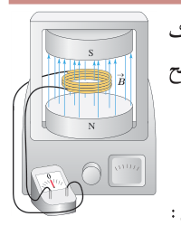
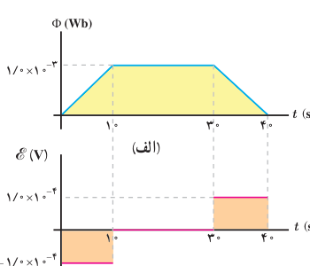

### مثال ۴ـ۲

پیچه‌ای شامل ۲۰۰ دور که مساحت هر حلقۀ آن $25\,\mathrm{cm^2}$ است، مطابق شکل روبه‌رو بین قطب‌های یک آهن‌ربای الکتریکی قرار گرفته است که میدان مغناطیسی یکنواخت تولید می‌کند. خط‌های میدان بر سطح پیچه عمودند. اگر اندازۀ میدان در بازۀ زمانی ۲/۰ ms از ۰/۱۸ T به ۰/۲۲ T افزایش یابد، الف) نیروی محرکۀ القایی متوسط ایجاد شده در پیچه چقدر است؟ ب) اگر مقاومت پیچه ۱۰ Ω باشد، جریان القایی متوسط که از پیچه می‌گذرد چقدر است؟

**پاسخ:** الف) نیم‌خط عمود بر سطح حلقه‌های پیچه را همسو با $\vec B$ می‌گیریم. با توجه به داده‌های مسئله داریم:

$$N=200\text{ دور},\quad A=25\,\mathrm{cm^2},\quad\theta=0^\circ,\quad\Delta t=2/0\,\mathrm{ms},\quad B_1=0/18\,\mathrm T,\quad B_2=0/22\,\mathrm T$$
$$\Phi_1=B_1A\cos\theta=(0/18\,\mathrm T)(2/5\times10^{-3}\,\mathrm{m^2})(\cos0^\circ)=4/5\times10^{-4}\,\mathrm{Wb}$$
$$\Phi_2=B_2A\cos\theta=(0/22\,\mathrm T)(2/5\times10^{-3}\,\mathrm{m^2})(\cos0^\circ)=5/5\times10^{-4}\,\mathrm{Wb}$$

به این ترتیب، تغییر شار مغناطیسی برابر است با:

$$\Delta\Phi=\Phi_2-\Phi_1=(5/5\times10^{-4}\,\mathrm{Wb})-(4/5\times10^{-4}\,\mathrm{Wb})=1/0\times10^{-4}\,\mathrm{Wb}$$

با قرار دادن این مقدار و داده‌های بالا در رابطۀ ۴ـ۲ داریم:

$$\mathcal E_{av}=-N\frac{\Delta\Phi}{\Delta t}=-(200)\frac{1/0\times10^{-4}\,\mathrm{Wb}}{2/0\times10^{-3}\,\mathrm s}=-10\,\mathrm V$$

ب) با توجه به رابطۀ ۴ـ۳، جریان القایی متوسط در پیچه برابر است با:

$$I_{av}=\frac{\mathcal E_{av}}R=\frac{-10\,\mathrm V}{10\,\Omega}=-1/0\,\mathrm A$$

### مثال ۴ـ۳

تغییرات شار مغناطیسی که از یک حلقه می‌گذرد برحسب زمان در نمودار شکل الف نشان داده شده است. نمودار نیروی محرکۀ القایی در حلقه را برحسب زمان در هریک از بازه‌های زمانی $(0,10\,\mathrm s)$، $(10\,\mathrm s,30\,\mathrm s)$ و $(30\,\mathrm s,40\,\mathrm s)$ رسم کنید.

**پاسخ:** همان‌طور که در نمودار شار مغناطیسی برحسب زمان دیده می‌شود، در بازۀ زمانی صفر تا ۱۰ s شار به‌صورت خطی افزایش می‌یابد. در نتیجه مقدار لحظه‌ای آهنگ تغییر شار با مقدار متوسط آن برابر است. به این ترتیب، در تمامی لحظات این بازۀ زمانی، نیروی محرکۀ القایی با نیروی محرکۀ القایی متوسط برابر است:

$$\mathcal E_{av}=-N\frac{\Delta\Phi}{\Delta t}=-(1)\frac{1/0\times10^{-3}\,\mathrm{Wb}-0}{10\,\mathrm s}=-1/0\times10^{-4}\,\mathrm V$$

در بازۀ زمانی ۱۰ s تا ۳۰ s شار ثابت مانده است. در نتیجه نیروی محرکۀ القایی در تمامی لحظات این بازۀ زمانی برابر صفر است. در بازۀ زمانی ۳۰ s تا ۴۰ s شار به صورت خطی کاهش یافته و سرانجام صفر شده است. بنابراین شبیه آنچه در مورد بازۀ زمانی صفر تا ۱۰ s گفتیم، نیروی محرکۀ القایی در تمام لحظات این بازه با مقدار متوسط نیروی محرکه در این بازۀ زمانی برابر و مساوی $1/0\times10^{-4}\,\mathrm V$ است. نمودار نیروی محرکۀ القایی برحسب زمان در شکل ب رسم شده است.
