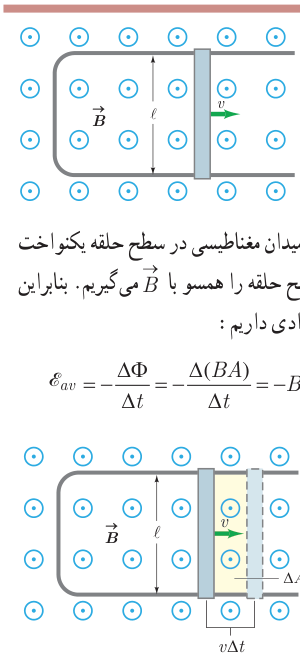
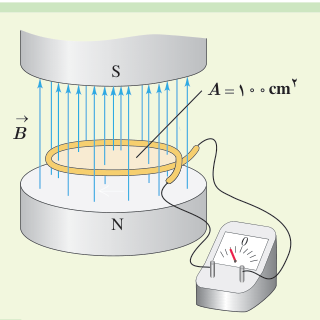

### مثال ۴ـ۴

شکل روبه‌رو، رسانای U شکلی را درون میدان مغناطیسی یکنواخت $\vec B$ به اندازۀ ۰/۱۸ T نشان می‌دهد. میدان $\vec B$ عمود بر صفحۀ شکل و رو به بیرون است. میله‌ای فلزی (سیم لغزنده) به طول $\ell=20\,\mathrm{cm}$ بین دو بازوی رسانا قرار دارد و مداری را تشکیل می‌دهد. میله را با تندی ثابت $v=20\,\mathrm{m/s}$ به‌طرف راست حرکت می‌دهیم. بزرگی نیروی محرکۀ القایی متوسط را پیدا کنید.

**پاسخ:** با حرکت میلۀ فلزی و به‌دلیل افزایش سطح حلقه، شار مغناطیسی تغییر می‌کند. میدان مغناطیسی در سطح حلقه یکنواخت است، پس شار مغناطیسی را از رابطۀ $\Phi=BA\cos\theta$ محاسبه می‌کنیم. نیم‌خط عمود بر سطح حلقه را همسو با $\vec B$ می‌گیریم. بنابراین زاویۀ نیم‌خط عمود با میدان $\vec B$ صفر است ($\theta=0$) و در نتیجه $\Phi=BA$. از قانون القای فارادی داریم:

$$\mathcal E_{av}=-\frac{\Delta\Phi}{\Delta t}=-\frac{\Delta(BA)}{\Delta t}=-B\frac{\Delta A}{\Delta t}$$

برای محاسبۀ $\Delta A/\Delta t$، توجه کنید که میلۀ فلزی لغزنده در مدت $\Delta t$ مسافت $v\Delta t$ را طی می‌کند (شکل روبه‌رو) و سطح حلقه به مقدار $\Delta A=\ell v\Delta t$ افزایش می‌یابد. به این ترتیب، نیروی محرکۀ القا شده برابر است با:

$$\mathcal E_{av}=-B\frac{\ell v\Delta t}{\Delta t}=-B\ell v$$

با قرار دادن مقادیر داده شده، در رابطۀ بالا، داریم:

$$\mathcal E_{av}=-(0/18\,\mathrm T)(20\times10^{-2}\,\mathrm m)(20\,\mathrm{m/s})=-0/72\,\mathrm V$$

و بزرگی آن برابر است با $|\mathcal E_{av}|=0/72\,\mathrm V$.

توجه کنید که به علت ثابت بودن تندی میلۀ لغزنده، نیروی محرکۀ القایی ثابت است. در این حالت، رسانای U شکل با سیم لغزنده یک مولد جریان مستقیم است.

### تمرین ۴ـ۲

میدان مغناطیسی بین قطب‌های آهن‌ربای الکتریکی شکل روبه‌رو که بر سطح حلقه عمود است با زمان تغییر می‌کند و در مدت ۰/۴۵ s از ۰/۲۸ T رو به بالا، به ۰/۱۷ T رو به پایین می‌رسد. در این مدت، الف) نیروی محرکۀ القایی متوسط در حلقه را به‌دست آورید. ب) اگر مقاومت حلقه ۱۰ Ω باشد، جریان القایی متوسط در حلقه را پیدا کنید.

