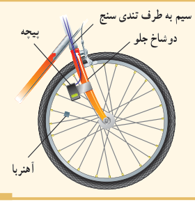
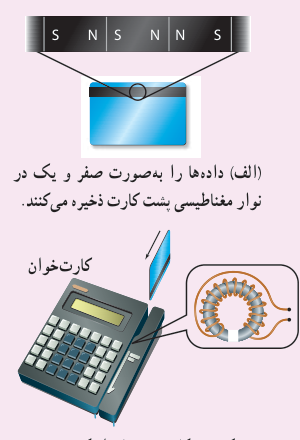
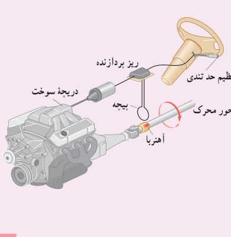

### پرسش ۴ـ۲

تندی‌سنج دوچرخه‌های مسابقه‌ای شامل یک آهن‌ربای کوچک و یک پیچه است. آهن‌ربا به یکی از پره‌های چرخ جلو و پیچه به دو شاخ فرمان متصل است (شکل روبه‌رو). دو سر پیچه با سیم‌های رسانا به نمایشگر تندی‌سنج (که در واقع نوعی رایانۀ کوچک است) وصل شده است. به نظر شما تندی‌سنج دوچرخه چگونه کار می‌کند؟ این موضوع را در گروه خود به گفت‌وگو بگذارید و نتیجه را به کلاس درس ارائه دهید.

### فناوری و کاربرد: کارت‌های اعتباری و دستگاه‌های کارت‌خوان

نوار مغناطیسی پشت کارت‌های اعتباری حاوی تعداد بسیار زیادی ذرۀ فرومغناطیسی است که نوعی چسب خاص آنها را به هم متصل می‌کند. داده‌ها را که به‌صورت دودویی، یا صفر و یک به رمز درآورده‌اند، در نوار مغناطیسی پشت کارت ذخیره می‌کنند (شکل الف). وقتی کارت اعتباری درون دستگاه کارت‌خوان کشیده می‌شود، میدان مغناطیسی ناشی از نوار مغناطیسی، روی پیچۀ قرار داده شده در دستگاه کارت‌خوان اثر می‌گذارد و جریان اندکی را در پیچه القا می‌کند (شکل ب). این جریان بسیار کوچک توسط دستگاه دیگری تقویت و داده‌های ذخیره شده در نوار مغناطیسی پشت کارت، رمزگشایی می‌شود. پس از رمزگشایی داده‌ها، دستور مورد نظر انجام می‌شود.

الف) داده‌ها را به‌صورت صفر و یک در نوار مغناطیسی پشت کارت ذخیره می‌کنند. ب) کشیدن کارت، جریان اندکی در پیچۀ دستگاه کارت‌خوان القا می‌کند.

### سامانۀ تنظیم حد تندی خودرو¹

در بسیاری از خودروهای امروزی، سامانه‌ای وجود دارد که به کمک آن می‌توان تندی خودرو را روی مقدار دلخواهی تنظیم کرد. در این وضعیت، بدون آنکه لازم باشد راننده پای خود را روی پدال گاز قرار دهد، خودرو با تندی تعیین شده به حرکتش ادامه می‌دهد. اساس کار این سامانه، جریان القایی است. وقتی محور محرک خودرو می‌چرخد آهن‌ربایی که روی آن قرار دارد، شار مغناطیسی متغیری را از پیچه می‌گذراند و جریانی در آن القا می‌کند.

ریزپردازنده (مغز رایانه) تعداد تپ‌های جریان² را در هر ثانیه می‌شمارد و به این روش، تندی خودرو را اندازه می‌گیرد. سپس با مقایسۀ تندی اندازه‌گیری شده با تندی تنظیم شده توسط راننده، سوخت مورد نیاز را به موتور تزریق می‌کند. تا هنگامی که راننده ترمز نگیرد، حرکت خودرو با تندی تعیین شده، توسط این سامانه تنظیم می‌شود.

۱ـ Cruise Control Speed Limit System  ۲ـ Current pulses
