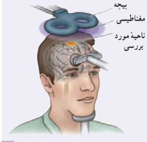
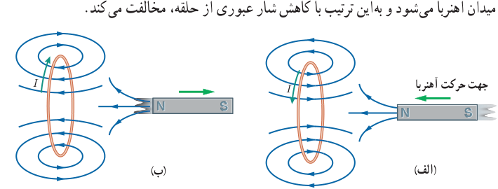

### خوب است بدانید: معاینۀ مغز با نیروهای محرکۀ القایی

برانگیزش (تحریک) مغناطیسی فرا جمجمه‌ای (TMS)¹ روشی برای بررسی عملکرد بخش‌های مختلف مغز است. در این روش، پیچه‌ای روی سر شخص بیمار قرار داده می‌شود که جریان الکتریکی متغیری از آن می‌گذرد و در نتیجه میدان مغناطیسی متغیری تولید می‌کند. این میدان متغیر، سبب ایجاد نیروی محرکۀ القایی و جریان القایی در ناحیه‌ای از مغز می‌شود که در زیر پیچه قرار دارد. پزشک با مشاهدۀ واکنش مغز (مثلاً اینکه کدام عضله‌ها به علت برانگیزش بخش خاصی از مغز حرکت می‌کنند) می‌تواند شرایط عصب‌شناختی مختلفی را بیازماید.

## ۴ـ۳ قانون لنز

مدت کوتاهی پس از آنکه فاراده قانون القای الکترومغناطیسی را ارائه کرد، هاینریش لنز، دانشمند روس‌تبار، در سال ۱۸۳۴ میلادی روشی را برای تعیین جهت جریان القایی در یک پیچه یا در هر مدار بستۀ دیگری پیشنهاد کرد. این روش که بعدها به قانون لنز شهرت یافت، حاکی از آن است که:

**جریان حاصل از نیروی محرکۀ القایی در یک مدار یا پیچه در جهتی است که آثار مغناطیسی ناشی از آن، با عامل به‌وجود آورندۀ جریان القایی، یعنی تغییر شار مغناطیسی، مخالفت می‌کند.**

علامت منفی در رابطۀ ۴ـ۲ نشان‌دهندۀ همین مخالفت است. توضیح دقیق‌تر این مطلب فراتر از سطح این کتاب است. در اینجا تنها به ذکر مثال‌هایی از چگونگی استفاده از قانون لنز برای تعیین جهت جریان القایی اکتفا می‌کنیم.

شکل ۴ـ۵ الف، آهن‌ربایی را نشان می‌دهد که قطب N آن در حال نزدیک شدن به یک حلقۀ رساناست. در این وضعیت اندازۀ $\vec B$ در محل حلقه افزایش می‌یابد و در نتیجه شار گذرنده از حلقه زیاد می‌شود. بنا به قانون لنز، جهت جریان القایی ایجاد شده در حلقه چنان است که میدان مغناطیسی ناشی از آن با افزایش شار مخالفت کند. بنابراین، میدان مغناطیسی حلقه در خلاف سوی میدان مغناطیسی آهن‌ربا می‌شود. با توجه به قاعدۀ دست راست و از روی جهت میدان مغناطیسی حلقه، جهت جریان در حلقه تعیین می‌شود. همچنین اگر مطابق شکل ۴ـ۵ ب، قطب N آهن‌ربا را از حلقۀ رسانا دور کنیم، جریان القایی در جهتی خواهد بود که میدان مغناطیسی تولید شده توسط حلقه، همسو با میدان آهن‌ربا می‌شود و به این ترتیب با کاهش شار عبوری از حلقه، مخالفت می‌کند.

شکل ۴ـ۵ الف) وقتی آهن‌ربا به حلقۀ رسانا نزدیک می‌شود جریان در جهتی در حلقه القا می‌شود که میدان مغناطیسی ناشی از آن با افزایش شار مغناطیسی حلقه مخالفت کند. ب) با دور شدن آهن‌ربا از حلقۀ رسانا، جریان در جهتی در حلقه القا می‌شود که میدان مغناطیسی ناشی از آن با کاهش شار مغناطیسی حلقه مخالفت کند.

### هاینریش فریدریش امیل لنز (۱۸۰۴–۱۸۶۵)

از فیزیک‌دانان مشهور آلمانی و دارای تبار روس بود. وی در استونی که در آن دوران تحت امپراتوری روسیه بود به دنیا آمد. پس از اتمام دورۀ دبیرستان در ۱۸۲۰ وارد دانشگاه تارتو شد و به تحصیل در زمینۀ فیزیک و شیمی پرداخت. لنز طی سال‌های ۱۸۲۳ تا ۱۸۲۶، در ضمن یک سفر دریایی به دور دنیا، به مطالعۀ شرایط آب و هوایی و همچنین ویژگی‌های فیزیک دریا پرداخت و نتایج آن را در سال ۱۸۳۱ منتشر کرد. پس از این سفر، در دانشگاه سن پترزبورگ آغاز به کار نمود. لنز مطالعۀ الکترومغناطیس را در سال ۱۸۳۱ شروع کرد و بیشتر شهرت وی فرمول‌بندی قانون لنز در الکترومغناطیس در سال ۱۸۳۴ است.

۱ـ Transcranial Magnetic Stimulation (TMS)
