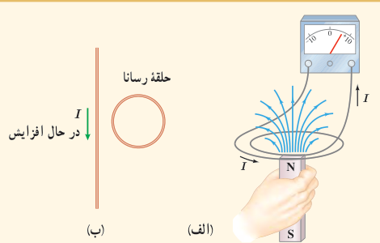
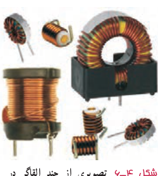
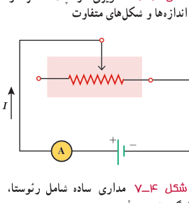

### پرسش ۴ـ۳

الف) با توجه به جهت جریان القایی در مدار شکل الف، توضیح دهید که آیا آهن‌ربا رو به بالا حرکت می‌کند یا رو به پایین.

ب) شکل ب سیم بلند و مستقیمی را نشان می‌دهد که جریان عبوری از آن در حال افزایش است. جهت جریان القایی را در حلقۀ رسانای مجاور سیم تعیین کنید.

### خوب است بدانید: اثر دیامغناطیس

چرخش هر الکترون به دور هستۀ اتم را می‌توان به‌صورت یک حلقۀ میکروسکوپی جریان مدل‌سازی کرد. هرگاه ماده‌ای در یک میدان مغناطیسی خارجی قرار گیرد، شار مغناطیسی گذرنده از هر یک از این حلقه‌های میکروسکوپی افزایش می‌یابد و در نتیجه بنا بر قانون لنز، در این حلقه‌ها، یک میدان مغناطیسی در خلاف جهت میدان مغناطیسی خارجی القا می‌شود. به این ویژگی که در اتم‌های همۀ مواد در حضور یک میدان مغناطیسی خارجی رخ می‌دهد، پدیدۀ یا اثر دیامغناطیس گفته می‌شود. اثر دیامغناطیسی در موادی نظیر بیسموت، جیوه، نقره، سرب، مس و کربن (الماس) بهتر نمایان می‌شود، زیرا اتم‌های آنها فاقد دوقطبی‌های مغناطیسی دائمی‌اند. از آنجا که اثر دوقطبی‌های مغناطیسی دائمی در مواد فرومغناطیسی و پارامغناطیسی بسیار بیشتر از اثر دوقطبی‌های القایی است، اثر دیامغناطیسی در این‌گونه مواد نمود کمتری دارد.

## ۴ـ۴ القاگرها

در فصل ۲ دیدیم که در فضای بین صفحه‌های یک خازن باردار، میدان الکتریکی ایجاد می‌شود و انرژی الکتریکی در این میدان ذخیره می‌شود. به همین ترتیب، می‌توان از القاگر (سیم‌پیچ) برای تولید میدان مغناطیسی دلخواه و همچنین ذخیرۀ انرژی در این میدان استفاده کرد. القاگر مانند مقاومت و خازن یکی از اجزای ضروری مدارهای الکترونیکی است.

شکل ۴ـ۶ تصویر چند القاگر را در اندازه‌ها و شکل‌های متفاوت نشان می‌دهد. نماد مداری القاگر، سیم‌پیچ است.

شکل ۴ـ۶ تصویری از چند القاگر در اندازه‌ها و شکل‌های متفاوت.

**خود ـ القاوری:** مداری را مطابق شکل ۴ـ۷ در نظر بگیرید. این مدار شامل منبع نیروی محرکه، رئوستا، آمپرسنج و القاگری است که به‌طور متوالی به یکدیگر بسته شده‌اند. با تغییر مقاومت رئوستا، جریان در مدار تغییر می‌کند. تغییر جریان در مدار، سبب تغییر میدان مغناطیسی القاگر می‌شود و در نتیجه شار مغناطیسی عبوری از آن نیز تغییر می‌کند. این فرایند سبب القای نیروی محرکه‌ای در القاگر می‌شود که بنابر قانون لنز با تغییر جریان عبوری از آن مخالفت می‌کند. این پدیده که می‌تواند در هر القاگری (از قبیل پیچه یا سیم‌لوله) رخ دهد اثر **خود ـ القاوری** نامیده می‌شود.

شکل ۴ـ۷ مداری ساده شامل رئوستا، القاگر، باتری و آمپرسنج.
