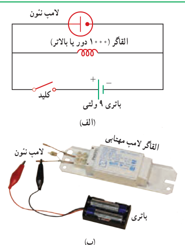
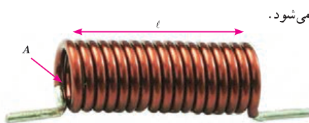

## آزمایش ۴ـ۲

**هدف: بررسی اثر خود ـ القاوری**

**وسیله‌های مورد نیاز:** لامپ نئون (لامپ فازمتری)، القاگر (۱۰۰۰ دور یا بالاتر)، باتری قلمی (۲ عدد) یا باتری ۹ ولتی، سیم رابط، کلید

**شرح آزمایش:**

• مداری مطابق شکل الف ببندید.

• کلید را وصل کنید. آیا لامپ روشن است؟ اینک کلید را قطع کنید. در لحظۀ قطع کردن کلید چه چیزی مشاهده می‌کنید؟ دلیل آنچه را مشاهده می‌کنید در گروه خود به گفت‌وگو بگذارید و نتیجه را به کلاس ارائه دهید.

**توجه:** می‌توانید مطابق شکل ب، به جای القاگر از القاگر لامپ‌های مهتابی (که به اشتباه ترانس نامیده می‌شود) نیز استفاده کنید.

### خوب است بدانید: کاربرد القاگرها در سامانه‌های انتقال برق

برخورد آذرخش به بخشی از یک سامانۀ انتقال توان الکتریکی موجب افزایش ناگهانی ولتاژ می‌شود که می‌تواند به اجزای سامانه و هر چیز دیگری که به آن وصل باشند (برای مثال، وسیله‌های برق خانگی) آسیب برساند. برای کمینه کردن این آثار، القاگرهای بزرگی را در مسیر سامانۀ انتقال قرار می‌دهند. این کار باعث می‌شود که القاگر با هر تغییر سریع در جریان مخالفت کند و آن را فرو نشاند!

**ضریب القاوری:** ویژگی‌های فیزیکی هر القاگر، توسط ضریب القاوری آن تعیین می‌شود. ضریب القاوری که با نماد $L$ نمایش داده می‌شود به عواملی همچون تعداد دور، طول و سطح مقطع القاگر و جنس هسته‌ای که داخل آن قرار می‌گیرد بستگی دارد. برای مثال، ضریب القاوری سیم‌لوله‌ای آرمانی و بدون هسته، که دارای طول $\ell$، سطح مقطع $A$ و $N$ حلقۀ نزدیک به هم است (شکل ۴ـ۸)، از رابطۀ زیر به‌دست می‌آید:

$$L=\mu_0\frac{AN^2}{\ell}\tag{4-4}$$

یکای SI ضریب القاوری، اهم.ثانیه ($\Omega\cdot\mathrm s$) است که به احترام جوزف هانری، هانری نامیده و با نماد H نشان داده می‌شود.

شکل ۴ـ۸ سیم‌لوله‌ای با N حلقۀ نزدیک به هم.

### جوزف هانری (۱۷۹۷–۱۸۷۸)

یکی از فیزیک‌دانان تجربی قرن نوزدهم است که در امریکا به دنیا آمد و کار خود را با آموزش علوم در یک مدرسۀ روستایی آغاز کرد. سپس به تحصیل در طب و مهندسی علاقه‌مند شد و سرانجام به فیزیک و ریاضیات روی آورد. هانری در سال ۱۸۳۱، همزمان و مستقل از فاراده، موفق به کشف پدیدۀ القای الکترومغناطیسی شد. وی همچنین توانست نوعی موتور الکترومغناطیسی و یک تلگراف جدید و کارآمد اختراع کند. یکای SI ضریب القاوری به احترام یک عمر فعالیت‌های علمی وی، هانری (H) انتخاب شده است.
