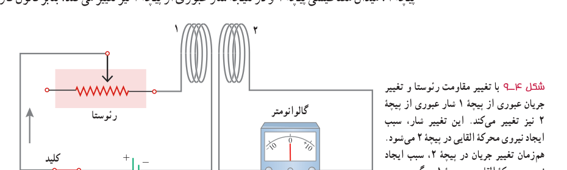

### مثال ۴ـ۵

ضریب القاوری سیم‌لولۀ آرمانی بدون هسته‌ای به طول ۶۲/۸ cm و سطح مقطع $10\,\mathrm{cm^2}$ را پیدا کنید که شامل ۲۰۰۰ حلقۀ نزدیک به هم است.

**پاسخ:** با توجه به داده‌های مسئله داریم:

$$A=10\,\mathrm{cm^2},\quad\ell=62/8\,\mathrm{cm},\quad N=2000\text{ دور},\quad L=?$$

با قرار دادن مقادیر بالا در رابطۀ ۴ـ۴ داریم:

$$L=\mu_0\frac{AN^2}{\ell}=(4\pi\times10^{-7}\,\mathrm{T.m/A})\frac{(10\times10^{-4}\,\mathrm{m^2})(2000)^2}{0/628\,\mathrm m}=8/0\times10^{-3}\,\mathrm H=8/0\,\mathrm{mH}$$

### تمرین ۴ـ۳

۱ـ تعداد حلقه‌های سیم‌لوله‌ای بدون هسته، به طول ۲۸ cm و سطح $10\,\mathrm{cm^2}$ چه تعداد باشد تا ضریب القاوری آن ۱/۰ H شود؟

۲ـ دو سیم‌لولۀ بدون هسته با سطح مقطع و تعداد دور یکسان را در نظر بگیرید. اگر طول یکی از سیم‌لوله‌ها دو برابر دیگری باشد، ضریب القاوری‌اش چند برابر دیگری است؟

### خوب است بدانید: کاربرد القاگرها در لامپ‌های فلوئورسان

همان‌طور که در ابتدای این بخش دیدیم القاگرها با تغییرات سریع جریان در مدار مخالفت می‌کنند، به همین دلیل نقش مهمی در لامپ‌های فلوئورسان (مهتابی) دارند. در این لامپ‌ها، جریان الکتریکی از گاز رقیقی که فضای درون لامپ را پر کرده است می‌گذرد و گاز را یونیده و به پلاسما تبدیل می‌کند. پلاسما یک رسانای غیراهمی است و هرچه بیشتر یونیده شود مقاومت آن کمتر می‌شود. اگر ولتاژ به حد کافی بالایی به گاز اعمال شود، جریان می‌تواند بسیار زیاد شود و به مدار بیرونی لامپ فلوئورسان آسیب برساند. برای جلوگیری از این مسئله، یک القاگر را به‌طور متوالی با لامپ فلوئورسان می‌بندند تا مانع افزایش زیاد جریان شود. متعادل‌کننده همچنین باعث می‌شود تا لامپ فلوئورسان بتواند با ولتاژ متناوب کار کند.

**القای متقابل:** شکل ۴ـ۹ اسباب آزمایش ساده‌ای را برای بررسی اثر القای متقابل نشان می‌دهد. جریان عبوری از پیچۀ ۱، میدان مغناطیسی $\vec B$ را به‌وجود می‌آورد. این میدان $\vec B$، شار مغناطیسی‌ای را از پیچۀ ۲ می‌گذراند که در مجاورت آن قرار دارد. با تغییر دادن مقاومت رئوستا و تغییر جریان در پیچۀ ۱، میدان مغناطیسی پیچۀ ۱ و در نتیجه شار عبوری از پیچۀ ۲ نیز تغییر می‌کند؛ بنابر قانون فاراده،

شکل ۴ـ۹ با تغییر مقاومت رئوستا و تغییر جریان عبوری از پیچۀ ۱ شار عبوری از پیچۀ ۲ نیز تغییر می‌کند. این تغییر شار، سبب ایجاد نیروی محرکۀ القایی در پیچۀ ۲ می‌شود. هم‌زمان تغییر جریان در پیچۀ ۲، سبب ایجاد نیروی محرکۀ القایی در پیچۀ ۱ می‌گردد.
