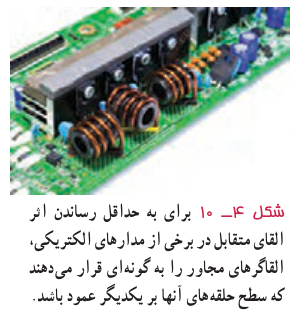
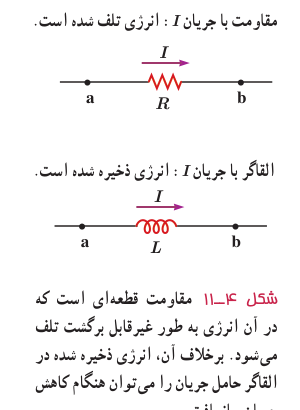

این تغییر شار، نیروی محرکه‌ای را در پیچۀ ۲ القا می‌کند که به ایجاد جریان القایی در این پیچه می‌انجامد. همچنین تغییر جریان در پیچۀ ۲، سبب ایجاد نیروی محرکۀ القایی در پیچۀ ۱ می‌شود. این فرایند، **القای متقابل** نامیده می‌شود و به کمک آن می‌توان انرژی را از یک پیچه، به پیچۀ دیگر منتقل کرد.

در برخی از مدارهایی که از چندین القاگر به‌وجود آمده است، تغییرات جریان در یک القاگر می‌تواند نیروهای محرکۀ ناخواسته‌ای را در القاگرهای مجاور القا کند. به همین دلیل، در برخی از مدارهای الکتریکی، القای متقابل می‌تواند مزاحم باشد. برای هرچه کمتر کردن این اثر ناخواسته، باید سطح حلقه‌های القاگرهای مجاور را به‌طور عمود بر یکدیگر قرار داد (شکل ۴ـ۱۰). در این صورت، اثر القای متقابل تا حد امکان کوچک می‌شود. القای متقابل کاربردهای مفید بسیاری نیز دارد. مثلاً در مبدل‌ها که در پایان همین فصل با آنها آشنا خواهید شد، القای متقابل، نقش مهمی در مقدار ولتاژ خروجی مبدل ایفا می‌کند.

شکل ۴ـ۱۰ برای به حداقل رساندن اثر القای متقابل در برخی از مدارهای الکتریکی، القاگرهای مجاور را به‌گونه‌ای قرار می‌دهند که سطح حلقه‌های آنها بر یکدیگر عمود باشد.

**انرژی ذخیره شده در القاگر در پدیدۀ خودـالقاوری:** وقتی توسط باتری جریانی در القاگر برقرار شود، مولد به القاگر انرژی می‌دهد. بخشی از این انرژی در مقاومت الکتریکی سیم‌های القاگر به صورت گرما تلف و بقیۀ آن در میدان مغناطیسی القاگر ذخیره می‌شود. مقدار انرژی ذخیره شده در میدان القاگر با ضریب القاوری $L$، از رابطۀ زیر به‌دست می‌آید:

$$U=\frac12LI^2\tag{4-5}$$

لازم است رفتار مقاومت و القاگر را به لحاظ انرژی اشتباه نگیرید (شکل ۴ـ۱۱). هنگام عبور جریان از مقاومت، انرژی وارد آن می‌شود، جریان چه پایا باشد و چه تغییر کند، این انرژی در مقاومت به انرژی گرمایی تبدیل می‌شود؛ درحالی که در یک القاگر آرمانی (با مقاومت صفر) تنها وقتی انرژی وارد القاگر می‌شود که جریان در آن افزایش یابد. این انرژی تلف نمی‌شود؛ بلکه در میدان مغناطیسی القاگر ذخیره شده و هنگام کاهش جریان، آزاد می‌شود. هنگام عبور جریان پایا از یک القاگر آرمانی (سیم‌پیچ بدون مقاومت)، انرژی به آن وارد یا از آن خارج نمی‌شود.

شکل ۴ـ۱۱ مقاومت قطعه‌ای است که در آن انرژی به‌طور غیرقابل برگشت تلف می‌شود. برخلاف آن، انرژی ذخیره شده در القاگر حامل جریان را می‌توان هنگام کاهش جریان بازیافت.

### مثال ۴ـ۶

متخصصان صنعت برق، علاقه‌مندند راه‌های مؤثری را برای ذخیرۀ انرژی الکتریکی تولیدی در ساعت‌های کم‌مصرف (کم‌باری) بیابند تا با استفاده از آن، نیاز مشترکان را در ساعت‌های پرمصرف (اوج بار) تأمین کنند. یک ایدۀ فرضی، استفاده از یک القاگر بزرگ است. ضریب القاوری این القاگر چقدر باشد تا بتواند $1/0\,\mathrm{kWh}$ انرژی الکتریکی را در پیچۀ حامل جریان $200\,\mathrm A$ ذخیره کند؟

**پاسخ:** مقدار انرژی ذخیره‌شدۀ مورد نیاز $U=1/0\,\mathrm{kWh}$ و جریان $I=200\,\mathrm A$ داده شده است. از معادلۀ ۴ـ۵ ضریب القاوری را به‌دست می‌آوریم:

$$U=1/0\,\mathrm{kWh}=(1/0\times10^3\,\mathrm W)(3600\,\mathrm s)=3/6\times10^6\,\mathrm J$$
$$U=\frac12LI^2\Rightarrow L=\frac{2U}{I^2}=\frac{2(3/6\times10^6\,\mathrm J)}{(200\,\mathrm A)^2}=1/8\times10^2\,\mathrm H$$
