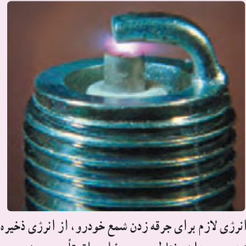
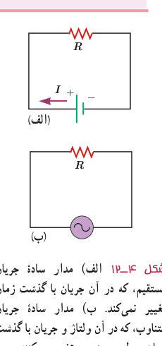

همان‌طور که نتیجۀ صفحۀ قبل نشان می‌دهد ضریب القاوری لازم، بسیار بیشتر از ضریب القاوری یک القاگر معمولی (در حد میلی‌هانری) است که در آزمایشگاه از آن استفاده می‌کنیم. افزون بر این همان‌طور که در فصل ۲ دیدیم سیم‌های معمولی که بتوانند جریان ۲۰۰ A را از خود عبور دهند باید قطر بسیار بزرگی داشته باشند. در نتیجه اندازۀ یک القاگر ۱۸۰ H که از سیم‌های معمولی ساخته شده باشد و بتواند چنین جریانی را تحمل کند باید خیلی بزرگ (به اندازۀ یک اتاق بزرگ) باشد. با توجه به فناوری‌های موجود این ایده، غیرعملی است و توجیه اقتصادی ندارد.

### تمرین ۴ـ۴

سیم‌لولۀ آرمانی بدون هسته‌ای به طول ۲۲ cm و با حلقه‌هایی به مساحت $0/44\,\mathrm{cm^2}$، شامل $N=2000$ حلقۀ نزدیک به هم است و جریان ۱/۷ A از آن می‌گذرد. ضریب القاوری و انرژی ذخیره شده در سیم‌لوله را حساب کنید.

### فناوری و کاربرد: انرژی لازم برای جرقه زدن شمع خودرو

انرژی ذخیره شده در میدان مغناطیسی نقش مؤثری در دستگاه‌های احتراق خودروهای با موتور بنزینی دارد. پیچۀ اولیه با حدود ۲۵۰ دور به باتری خودرو بسته شده است و میدان مغناطیسی قوی‌ای تولید می‌کند. این پیچه، درون یک پیچۀ ثانویه با ۲۵۰۰ دور سیم خیلی نازک قرار گرفته است. برای جرقه زدن شمع، جریان در پیچۀ اولیه قطع می‌شود و میدان مغناطیسی به سرعت به صفر می‌رسد و نیروی محرکۀ الکتریکی ده‌ها هزار ولتی در پیچۀ ثانویه القا می‌کند. در نتیجه انرژی ذخیره شده در میدان مغناطیسی همراه با جریانی لحظه‌ای از پیچۀ ثانویه به طرف شمع می‌رود و جرقه‌ای تولید می‌کند که سبب احتراق مخلوط سوخت و هوا در سیلندرهای موتور می‌شود (شکل روبه‌رو).

انرژی لازم برای جرقه زدن شمع خودرو، از انرژی ذخیره شده در میدان مغناطیسی پیچۀ احتراق تأمین می‌شود.

## ۴ـ۵ جریان متناوب

در اواخر قرن نوزدهم، بحث‌های داغی بین توماس ادیسون و جورج وستینگهاوس دربارۀ بهترین روش انتقال انرژی الکتریکی از محل تولید تا محل مصرف صورت گرفت. ادیسون موافق جریان مستقیم (dc) بود، در حالی که وستینگهاوس از جریان متناوب (ac) حمایت می‌کرد. سرانجام، وستینگهاوس پیروز شد و پس از آن سامانه‌های انتقال و توزیع برق و بیشتر وسایل خانگی با جریان متناوب به کار افتادند.

شکل ۴ـ۱۲ دو مدار سادۀ جریان مستقیم و جریان متناوب را نشان می‌دهد. همان‌طور که می‌بینید جهت جریان در مدار جریان مستقیم معین است، درحالی که در مدار جریان متناوب، به دلیل تغییر جهت جریان با گذشت زمان، نمی‌توان جهت معینی را برای جریان در نظر گرفت. تمامی نیروگاه‌های تولید برق در دنیا و از جمله ایران، جریان متناوب تولید می‌کنند که تابعی سینوسی از زمان است و به همین دلیل، جریان متناوب سینوسی نامیده می‌شود (شکل ۴ـ۱۳).

شکل ۴ـ۱۲ الف) مدار سادۀ جریان مستقیم، که در آن جریان با گذشت زمان تغییر نمی‌کند. ب) مدار سادۀ جریان متناوب، که در آن ولتاژ و جریان با گذشت زمان به‌طور سینوسی تغییر می‌کنند.
