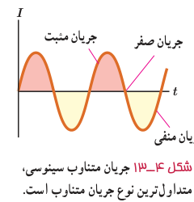
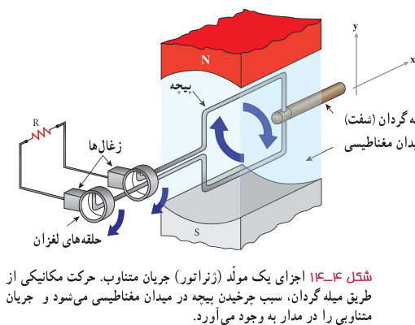

**تولید جریان متناوب:** یکی از کاربردهای مهم اثر القای الکترومغناطیسی، تولید جریان متناوب است. پیش از این دیدیم که برای تولید نیروی محرکۀ القایی باید شار عبوری از پیچه تغییر کند. همچنین دیدیم که در حضور میدان مغناطیسی یکنواخت، شاری که از پیچه می‌گذرد از رابطۀ $\Phi=BA\cos\theta$ محاسبه می‌شود که در آن $\theta$ زاویۀ بین نیم‌خط عمود بر سطح حلقه‌های پیچه و میدان مغناطیسی است.

رایج‌ترین روش برای تغییر شار و در نتیجه تولید جریان القایی، تغییر زاویۀ $\theta$ است. شکل ۴ـ۱۴ پیچه‌ای را نشان می‌دهد که می‌تواند در میدان مغناطیسی یکنواخت دور محور x بچرخد.

شکل ۴ـ۱۳ جریان متناوب سینوسی، متداول‌ترین نوع جریان متناوب است.

شکل ۴ـ۱۴ اجزای یک مولد (ژنراتور) جریان متناوب. حرکت مکانیکی از طریق میلۀ گردان، سبب چرخیدن پیچه در میدان مغناطیسی می‌شود و جریان متناوبی را در مدار به وجود می‌آورد.

هر دور چرخش پیچه، معادل $2\pi$ رادیان است. اگر پیچه به‌طور یکنواخت بچرخد و هر دور چرخش آن $T$ ثانیه طول بکشد، پیچه در مدت $t$ ثانیه، به اندازۀ $t/T$ دور خواهد چرخید. در نتیجه اگر سطح پیچه در لحظۀ $t=0$ عمود بر میدان مغناطیسی باشد ($\theta=0$)، پس از گذشت $t$ ثانیه، زاویۀ $\theta$ برابر $(2\pi)(t/T)$ رادیان است. زمان یک دور چرخش کامل پیچه ($T$) را **دوره یا زمان تناوب** می‌نامند. شاری که در لحظۀ $t$ از پیچه می‌گذرد برابر است با

$$\Phi=BA\cos\frac{2\pi}{T}t$$

به کمک قانون فاراده می‌توان نشان داد نیروی محرکۀ القایی در پیچه در لحظۀ $t$ از رابطۀ زیر به‌دست می‌آید:¹

$$\mathcal E=\mathcal E_m\sin\frac{2\pi}{T}t\tag{4-6}$$

که در آن $\mathcal E_m$ بیشینۀ مقدار نیروی محرکۀ القایی در پیچه است. این رابطه نشان می‌دهد که نیروی محرکۀ القا شده به‌طور دوره‌ای نسبت به زمان تغییر می‌کند.

۱ـ اثبات این رابطه، خارج از اهداف برنامۀ درسی این کتاب است.
