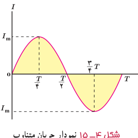
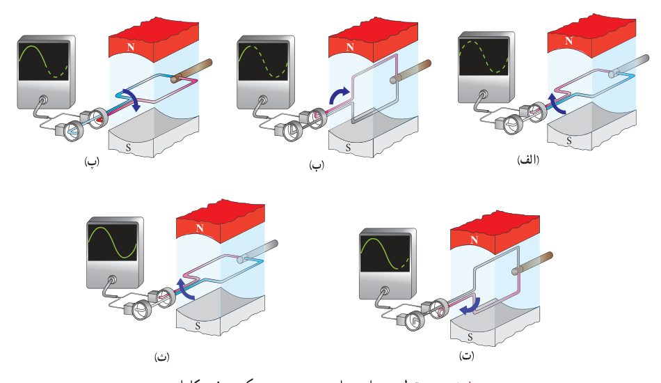

اگر مقاومت کل مدار پیچه برابر $R$ باشد، با توجه به رابطۀ $I=\mathcal E/R$، جریانی که در پیچه القا می‌شود برابر است با:

$$I=I_m\sin\frac{2\pi}{T}t\tag{4-7}$$

در این رابطه $I_m$ بیشینۀ جریان القا شده در پیچه و برابر $I_m=\mathcal E_m/R$ است. رابطۀ ۴ـ۷ همچنین نشان می‌دهد که جریان القایی در پیچه، به‌طور سینوسی تغییر می‌کند، به همین سبب به آن **جریان متناوب** می‌گویند. نمودار این جریان برحسب زمان، در یک دوره در شکل ۴ـ۱۵ رسم شده است.

شکل ۴ـ۱۵ نمودار جریان متناوب سینوسی در یک دوره.

شکل ۴ـ۱۶ تولید جریان متناوب سینوسی در مدت یک دوره را نشان می‌دهد. در $t=0$ سطح پیچه بر خطوط میدان مغناطیسی عمود است و جریانی در مدار وجود ندارد (شکل ۴ـ۱۶ الف). پیچه یک چهارم دور می‌چرخد تا در وضعیت شکل ۴ـ۱۶ ب قرار گیرد. در حین این چرخش، شار عبوری از پیچه تغییر می‌کند و جریان از صفر به مقدار بیشینۀ مثبت می‌رسد (ربع اول چرخش). پیچه به چرخیدن ادامه می‌دهد تا در وضعیت شکل ۴ـ۱۶ پ قرار گیرد. در نتیجه جریان از مقدار بیشینۀ مثبت به صفر می‌رسد (ربع دوم چرخش). پس از آن پیچه از وضعیت شکل ۴ـ۱۶ پ به وضعیت شکل ۴ـ۱۶ ت می‌رسد. در حین این چرخش، جریان از صفر به مقدار بیشینۀ منفی می‌رسد (ربع سوم چرخش). سرانجام پیچه یک ربع دور دیگر می‌چرخد و به این ترتیب یک چرخۀ کامل را طی می‌کند و به وضعیت شکل ۴ـ۱۶ ث می‌رسد و در نتیجه جریان از مقدار بیشینۀ منفی به صفر می‌رسد. این حرکت به‌طور متناوب (پی‌درپی) توسط پیچه ادامه می‌یابد و جریان متناوب تولید می‌شود.

شکل ۴ـ۱۶ تولید جریان متناوب سینوسی در یک چرخش کامل.
