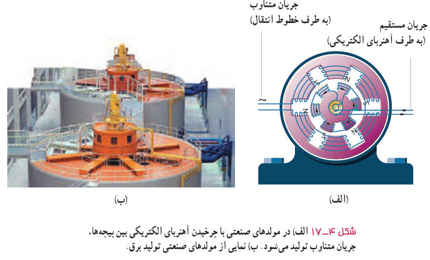
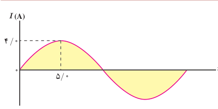

در نیروگاه‌های تولید برق، برای تولید جریان متناوب از مولدهای خاصی استفاده می‌شود که به آنها مولدهای صنعتی جریان متناوب می‌گویند. در مولدهای صنعتی پیچه‌ها ساکن‌اند و آهن‌ربای الکتریکی در آنها می‌چرخد (شکل ۴ـ۱۷). در نیروگاه‌های تولید برق در ایران، آهن‌ربای الکتریکی در هر ثانیه، ۵۰ دور درون پیچه می‌چرخد. این کمیت را بسامد برق تولید شده می‌نامند و به‌صورت ۵۰ Hz بیان می‌کنند. یکای SI بسامد $\mathrm{s^{-1}}$ یا Hz (هرتز) است.

شکل ۴ـ۱۷ الف) در مولدهای صنعتی با چرخیدن آهن‌ربای الکتریکی بین پیچه‌ها، جریان متناوب تولید می‌شود. ب) نمایی از مولدهای صنعتی تولید برق.

### مثال ۴ـ۷

شکل روبه‌رو، نمودار جریان متناوب سینوسی را نشان می‌دهد که یک مولد جریان متناوب تولید کرده است. معادلۀ جریان برحسب زمان را بنویسید.

**پاسخ:** چون ربع چرخه در ۵/۰ ms طی شده است، دوره تناوب برابر $T=20\,\mathrm{ms}$ است. همچنین با توجه به نمودار، بیشینۀ جریان $I_m=4/0\,\mathrm A$ است. در نتیجه از رابطۀ ۴ـ۷ داریم:

$$I=I_m\sin\frac{2\pi}{T}t=(4/0\,\mathrm A)\sin\left(\frac{2\pi}{20\times10^{-3}\,\mathrm s}\right)t=4/0\sin100\pi t$$

نتیجۀ نهایی برحسب یکاهای SI نوشته شده است.

### تمرین ۴ـ۵

معادلۀ جریان ـ زمان یک مولد جریان متناوب برحسب یکاهای SI به‌صورت $I=(4/0\times10^{-2})\sin250\pi t$ است. الف) جریان در دو لحظۀ $t_1=2/0\,\mathrm{ms}$ و $t_2=8/0\,\mathrm{ms}$ چقدر است؟ ب) دورۀ تناوب جریان را به‌دست آورید و نمودار جریان ـ زمان را در یک دورۀ کامل رسم کنید.
