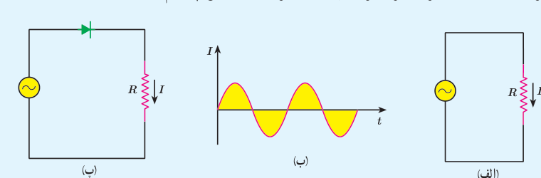
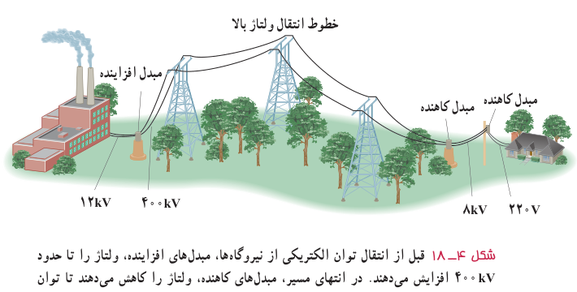

### فعالیت ۴ـ۱

در فصل ۲ دیدیم که دیود جریان را در یک جهت از خود عبور می‌دهد و در جهت دیگر مانع عبور جریان می‌شود. به همین دلیل آن را یک‌سوکنندۀ جریان می‌نامند. نمودار شکل ب، تغییرات جریان برحسب زمان را برای مدار شکل الف نشان می‌دهد. پس از گفت‌وگو در گروه خود، نمودار تغییرات جریان برحسب زمان را برای مدار شکل پ رسم کنید.

**مبدل‌ها:** یکی از مزیت‌های مهم توزیع توان الکتریکی ac بر dc آن است که افزایش و کاهش ولتاژ ac، بسیار آسان‌تر از dc است. برای انتقال توان الکتریکی در فاصله‌های دور، تا جایی که امکان دارد باید از ولتاژهای بالا و جریان‌های کم استفاده کنیم. این کار اتلاف توان را در خط‌های انتقال کاهش می‌دهد. همچنین با توجه به کاهش جریان می‌توان از سیم‌های نازک‌تری استفاده و در مصرف مواد اولیۀ ساخت سیم صرفه‌جویی کرد.

خط‌های انتقال توان الکتریکی به‌طور معمول از ولتاژهایی در حدود ۴۰۰ kV استفاده می‌کنند (شکل ۴ـ۱۸). از طرف دیگر، ملاحظات ایمنی و الزامات عایق‌بندی در ساخت وسایل خانگی و صنعتی، ولتاژهای به نسبت پایین‌تری را در محل مصرف انرژی ضروری می‌کند. ولتاژ استاندارد برای سیم‌کشی خانگی در ایران و بسیاری از کشورهای دیگر ۲۲۰ V است. تبدیل ولتاژ مورد نیاز با استفاده از مبدل‌ها صورت می‌گیرد.

شکل ۴ـ۱۸ قبل از انتقال توان الکتریکی از نیروگاه‌ها، مبدل‌های افزاینده، ولتاژ را تا حدود ۴۰۰ kV افزایش می‌دهند. در انتهای مسیر، مبدل‌های کاهنده، ولتاژ را کاهش می‌دهند تا توان الکتریکی با امنیت بیشتر به محل مصرف برسد.
