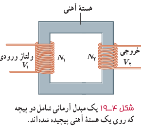
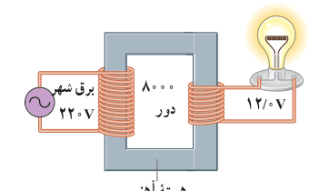
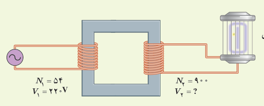

شکل ۴ـ۱۹ مبدلی شامل دو پیچه با تعداد دورهای متفاوت را نشان می‌دهد که دور یک هستۀ آهنی (فرومغناطیس نرم) پیچیده شده‌اند. در عمل پیچۀ اولیه با $N_1$ دور به ولتاژ $V_1$ بسته شده است و پیچۀ ثانویه با $N_2$ دور ولتاژ $V_2$ را تأمین می‌کند. برای یک مبدل آرمانی که مقاومت پیچه‌های آن ناچیز است، رابطۀ زیر برقرار است:¹

$$\frac{V_2}{V_1}=\frac{N_2}{N_1}\tag{4-8}$$

شکل ۴ـ۱۹ یک مبدل آرمانی شامل دو پیچه که روی یک هستۀ آهنی پیچیده شده‌اند.

### مثال ۴ـ۸

شکل روبه‌رو یک مبدل ۲۲۰ V به ۱۲/۰ V را نشان می‌دهد. پیچۀ اولیه ۸۰۰۰ دور دارد. با فرض آرمانی بودن مبدل، تعداد دورهای پیچۀ ثانویه را پیدا کنید.

**پاسخ:** با توجه به داده‌ها داریم:

$$V_1=220\,\mathrm V,\quad V_2=12/0\,\mathrm V,\quad N_1=8000\text{ دور},\quad N_2=?$$

با جای‌گذاری این مقادیر در رابطۀ ۴ـ۸ داریم:

$$\frac{V_2}{V_1}=\frac{N_2}{N_1}\Rightarrow\frac{12/0\,\mathrm V}{220\,\mathrm V}=\frac{N_2}{8000}\Rightarrow N_2=436\text{ دور}$$

### تمرین ۴ـ۶

برخی از وسیله‌های برقی، مانند حشره‌کش برقی، برای کار کردن نیاز به ولتاژهای بالا از مرتبۀ چند هزار ولت دارند. شکل زیر مبدلی را نشان می‌دهد که ولتاژ لازم را برای کار یک دستگاه حشره‌کش برقی فراهم می‌کند. اگر تعداد دور اولیۀ مبدل $N_1=54$ و تعداد دور ثانویه $N_2=900$ باشد، مبدل چه ولتاژی را برای کار کردن دستگاه حشره‌کش تأمین می‌کند؟

۱ـ لازم است توجه شود که ولتاژهای $V_1$ و $V_2$ تقریباً ۰/۷ برابر ولتاژ بیشینۀ ورودی و خروجی مبدل هستند. بررسی دلایل این موضوع خارج از اهداف این کتاب است.
