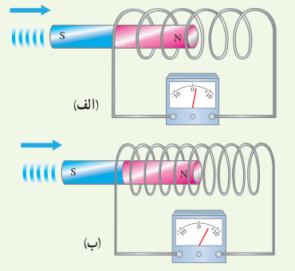
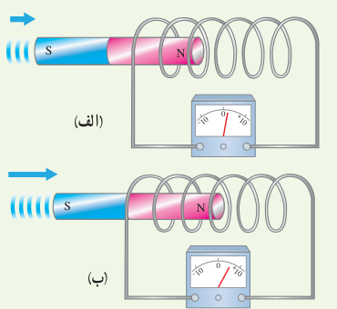
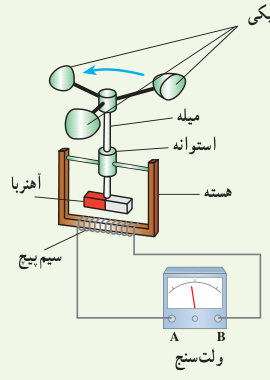
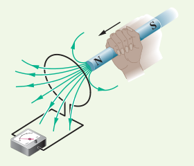

# پرسش‌ها و مسئله‌های فصل ۴

### ۴ـ۱ و ۴ـ۲ پدیدۀ القای الکترومغناطیسی و قانون القای الکترومغناطیسی فاراده

۱. دو سیملوله با حلقه‌های با مساحت یکسان ولی با تعداد دور متفاوت را مطابق شکل‌های زیر به ولت‌سنج حساسی وصل کرده‌ایم. دریافت خود را از این شکل‌ها بنویسید. (آهن‌رباها مشابه‌اند و با تندی یکسانی به‌طرف سیملوله‌ها حرکت می‌کنند.)

۲. دو سیملولۀ مشابه را مطابق شکل‌های زیر به ولت‌سنج حساسی وصل کرده‌ایم. دریافت خود را از شکل‌های زیر بنویسید. (آهن‌رباها مشابه‌اند ولی با تندی متفاوتی به‌طرف سیملوله حرکت می‌کنند.)

۳. شکل داده شده ساختمان یک بادسنج را نشان می‌دهد. اگر این بادسنج را روی بام خانه نصب کنیم، به هنگام وزیدن باد میلۀ آن می‌چرخد و ولت‌سنج عددی را نشان می‌دهد.

الف) چرا چرخش میله سبب انحراف عقربۀ ولت‌سنج می‌شود؟

ب) آیا با افزایش تندی باد، عددی که ولت‌سنج نشان می‌دهد تغییر می‌کند؟ چرا؟

پ) برای بهبود و افزایش دقت کار دستگاه دو پیشنهاد ارائه دهید.

۴. سطح حلقه‌های پیچه‌ای که دارای ۱۰۰۰ حلقه است، عمود بر میدان مغناطیسی یکنواختی که اندازۀ آن $0.040\,\mathrm T$ و جهت آن از راست به چپ است، قرار دارد. میدان مغناطیسی در مدت $0.010\,\mathrm s$ تغییر می‌کند و به $0.040\,\mathrm T$ در خلاف جهت اولیه می‌رسد. اگر سطح هر حلقۀ پیچه $50\,\mathrm{cm^2}$ باشد، اندازۀ نیروی محرکۀ القایی متوسط در پیچه را حساب کنید.

۵. مساحت هر حلقۀ پیچه‌ای $30\,\mathrm{cm^2}$ و پیچه متشکل از ۱۰۰۰ حلقه است. در ابتدا سطح پیچه‌ها بر میدان مغناطیسی زمین عمود است. اگر در مدت $0.020\,\mathrm s$ پیچه بچرخد و سطح حلقه‌ها موازی میدان مغناطیسی زمین شود، نیروی محرکۀ متوسط القایی در آن چقدر است؟ اندازۀ میدان مغناطیسی زمین را $0.50\,\mathrm G$ در نظر بگیرید.

### ۴ـ۳ قانون لنز

۶. قطب N یک آهن‌ربا را مطابق شکل روبه‌رو به یک حلقۀ رسانا نزدیک می‌کنیم. جهت جریان القایی در حلقه را مشخص کنید.

۷. دو آهن‌ربای میله‌ای مشابه را مطابق شکل، به‌طور قائم از ارتفاع معینی نزدیک سطح زمین رها می‌کنیم به‌طوری که یکی از آنها از حلقۀ رسانایی عبور می‌کند. اگر سطح زمین در محل
