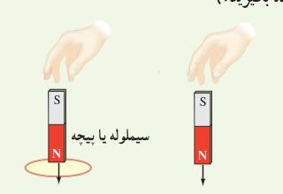
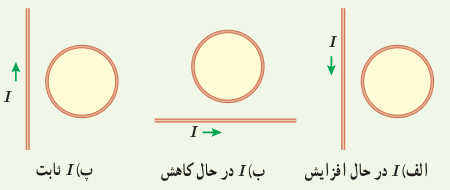
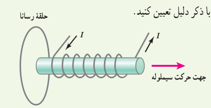
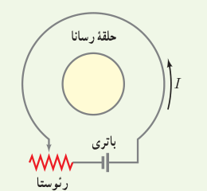
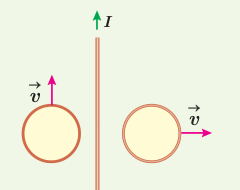
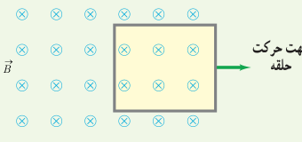
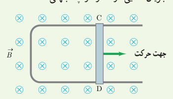
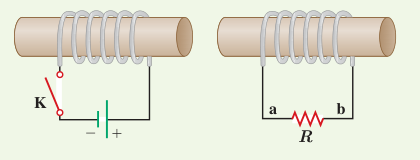

برخورد آهن‌رباها نرم باشد، مقدار فرورفتگی آهن‌رباها را در زمین با یکدیگر مقایسه کنید. (تأثیر میدان مغناطیسی زمین روی آهن‌رباها را نادیده بگیرید.)

۸. جهت جریان القایی را در هر یک از حلقه‌های رسانای نشان داده شده در شکل‌های زیر تعیین کنید.

۹. شکل زیر سیملولۀ حامل جریانی را نشان می‌دهد که در حال دور شدن از یک حلقۀ رساناست. جهت جریان القایی را در حلقه با ذکر دلیل تعیین کنید.

۱۰. اگر در مدار شکل زیر مقاومت رئوستا افزایش یابد، جریان القایی در حلقۀ رسانای داخلی در چه جهتی ایجاد می‌شود؟

۱۱. دو حلقۀ رسانا در نزدیکی یک سیم دراز حامل جریان ثابت $I$ قرار دارند؛ این دو حلقه با تندی یکسان، ولی در جهت‌های متفاوت مطابق شکل زیر حرکت می‌کنند. جهت جریان القایی را در هر حلقه با ذکر دلیل تعیین کنید.

۱۲. حلقۀ رسانای مستطیل شکل را مطابق شکل زیر به‌طرف راست می‌کشیم و از میدان مغناطیسی درون‌سویی خارج می‌کنیم. جهت جریان القایی در حلقه در چه جهتی است؟

۱۳. شکل زیر رسانای U شکلی را درون میدان مغناطیسی یکنواخت $\vec B$ که عمود بر صفحۀ شکل و رو به داخل صفحه است نشان می‌دهد. وقتی میلۀ فلزی CD به طرف راست حرکت کند، جهت جریان القایی در مدار در چه جهتی است؟

۱۴. در مدار نشان داده شده در شکل زیر، جهت جریان القایی را در مقاومت $R$ در هر یک از دو حالت زیر با ذکر دلیل پیدا کنید: الف) در لحظۀ بستن کلید K، ب) در لحظۀ باز کردن کلید K.

