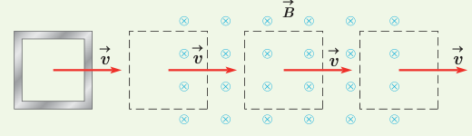
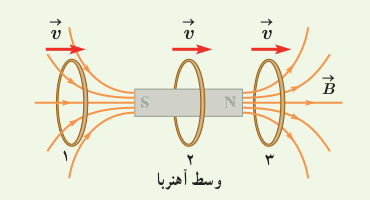
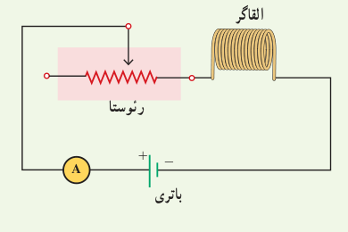
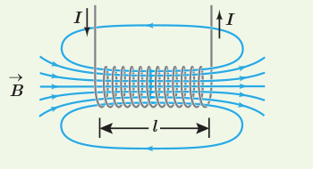
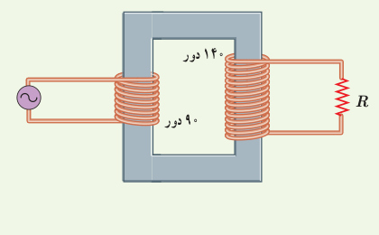

۱۵. حلقۀ رسانای مربعی شکل، به طول ضلع $10\,\mathrm{cm}$ وارد میدان مغناطیسی درون‌سویی به اندازۀ $20\,\mathrm{mT}$ و سپس از آن خارج می‌شود.

الف) در کدام مرحله شار عبوری از حلقه بیشینه است؟ مقدار شار گذرنده از حلقه در این حالت چقدر است؟

ب) در کدام وضعیت(ها) شار گذرنده از حلقه تغییر می‌کند؟ جهت جریان القایی را در حلقه تعیین کنید.

۱۶. حلقۀ رسانایی به‌طرف یک آهن‌ربای میله‌ای حرکت می‌کند. شکل زیر، حلقه را در سه وضعیت نسبت به آهن‌ربا نشان می‌دهد. جهت جریان القایی را در حلقه برای هر وضعیت به‌طور جداگانه تعیین کنید.

### ۴ـ۴ القاگرها

۱۷. شکل زیر مداری را نشان می‌دهد: شامل یک القاگر (سیملوله)، باتری، رئوستا و آمپرسنج که به‌طور متوالی به یکدیگر بسته شده‌اند. اگر بخواهیم بدون تغییر ولتاژ باتری، انرژی ذخیره شده در القاگر را زیاد کنیم چه راهی پیشنهاد می‌کنید؟

۱۸. مساحت هر حلقه و طول سیملولۀ شکل زیر به ترتیب $20\,\mathrm{cm^2}$ و $80\,\mathrm{cm}$ است. اگر این سیملوله از ۱۰۰۰ حلقۀ نزدیک به هم تشکیل شده باشد،

الف) ضریب القاوری آن را پیدا کنید.

ب) چه جریانی باید از سیملوله بگذرد تا در میدان مغناطیسی آن $0.40\,\mathrm{mJ}$ انرژی ذخیره شود؟

### ۴ـ۵ جریان متناوب

۱۹. جریان متناوبی که بیشینۀ آن $2.0\,\mathrm A$ و دورۀ آن $0.020\,\mathrm s$ است، از یک رسانای $5.0\,\Omega$ می‌گذرد.

الف) اولین لحظه‌ای که در آن جریان بیشینه است چه لحظه‌ای است؟ در این لحظه نیروی محرکۀ القایی چقدر است؟

ب) در لحظۀ $t=\frac{1}{400}\,\mathrm s$، جریان چقدر است؟

۲۰. در مبدل آرمانی شکل زیر، اگر ولتاژ دوسر مقاومت $R$ برابر $7.0\,\mathrm V$ باشد، ولتاژ مولد چقدر است؟

