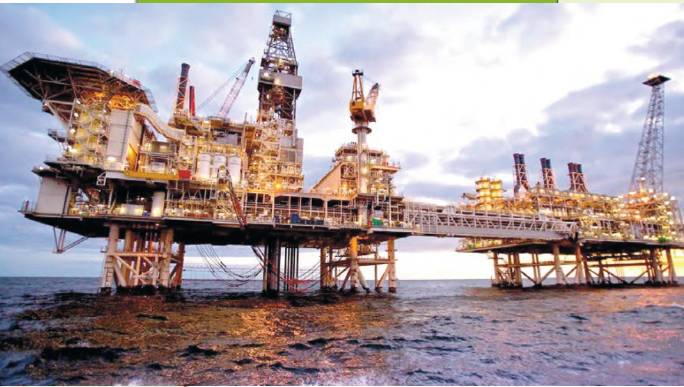

# فصل ۱: قدر هدایای زمینی را بدانیم

أَلَمْ تَرَوْا أَنَّ اللَّهَ سَخَّرَ لَكُمْ مَا فِي السَّمَاوَاتِ وَمَا فِي الْأَرْضِ وَ... (سوره لقمان ـ آیه ۲۰)

آیا ندیدید خداوند آنچه را در آسمان‌ها و زمین است مسخّر شما کرده و نعمت‌های آشکار و پنهان خود را به طور فراوان بر شما ارزانی داشته است.

زمین، خانه ماست. نه! زمین، تنها خانه ماست. در آن زاده می‌شویم و زندگی می‌کنیم. زمین سرشار از نعمت‌ها و هدایای پیدا و ناپیدای گوناگونی است که هر یک اندازه معینی دارد. هدایایی که انسان با شناخت و بهره‌گیری از آنها توانسته است با ساختن ابزار و دستگاه‌هایی به همه نقاط کره زمین از قطب شمال تا جنوب، اعماق دریاها و اقیانوس‌ها دست یابد و فضای دوردست و بی‌کران را نیز کشف کند. توانایی انسان در بیرون کشیدن موادی مانند نفت و فلزها به او این امکان را داده است تا سرپناهی ایمن و گرم برای زندگی خود فراهم سازد. دانش شیمی به ما کمک می‌کند تا ساختار دقیق این هدایا را شناسایی کنیم، به رفتار آنها پی ببریم و بهره‌برداری درست از آنها را بیاموزیم. باشد که دریابیم زمین، امانت خداست و دوستی با آن را باور کنیم.
