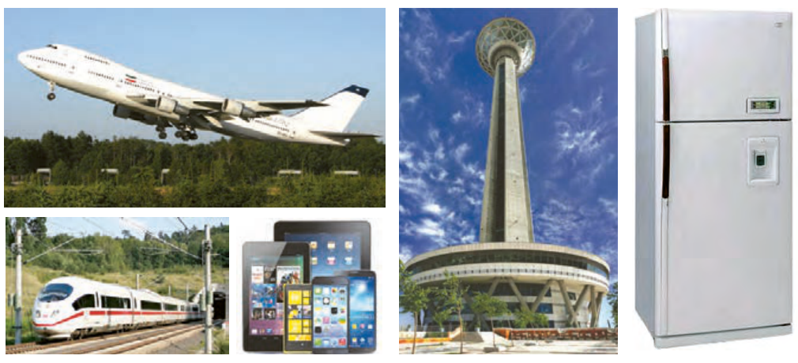

مواد در زندگی ما نقشی شگرف و مؤثر دارند به‌طوری که صنایع گوناگون مانند غذا، پوشاک، حمل‌ونقل، ساختمان، ارتباطات و هر بخش از زندگی ما کم‌وبیش تحت تأثیر مواد قرار دارند. اغراق نیست اگر رشد و گسترش تمدن بشری را در گرو کشف و شناخت مواد جدید بدانیم. بررسی تمدن‌ها از گذشته تاکنون نشان می‌دهد که توسعه جوامع انسانی به توانمندی افرادی هوشمند گره خورده است. آنان که توانسته‌اند برای رفع نیازهای خود و جامعه، موادی تولید کنند یا با دست‌کاری مواد، خواص آنها را تغییر دهند. انسان‌های پیشین فقط از برخی مواد طبیعی مانند چوب، سنگ، خاک، پشم و پوست بهره می‌بردند، اما با گذشت زمان توانستند موادی مانند سفال را تولید و برخی فلزها را نیز استخراج کنند که خواص مناسب‌تری داشتند.

با گسترش دانش تجربی، شیمی‌دان‌ها به رابطه میان خواص مواد با عنصرهای سازنده آنها پی بردند. آنها همچنین دریافتند که گرما دادن به مواد و افزودن آنها به یکدیگر سبب تغییر و گاهی بهبود خواص می‌شود. با این روند، آنها به توانایی انتخاب مناسب‌ترین ماده برای یک کاربرد معین دست یافتند تا جایی که می‌توانند موادی نو با ویژگی‌های منحصر به فرد و دلخواه طراحی کنند. امروزه با رشد و توسعه فناوری، هزاران ماده تهیه و تولید شده که زندگی مدرن و پیچیده امروزی را ممکن کرده است (شکل ۱).

گسترش فناوری به میزان دسترسی به مواد مناسب وابسته است، به‌طوری که کشف و درک خواص یک ماده جدید پرچمدار توسعه فناوری است. برای نمونه گسترش صنعت خودرو مدیون شناخت و دسترسی به فولاد است. همچنین پیشرفت صنعت الکترونیک بر اجزایی مبتنی است که از موادی به نام نیم‌رساناها ساخته می‌شوند.

## آیا می‌دانید

تمدن‌های آغازین را بر اساس گستره کاربردی مواد به سه دوره سنگی، برنزی و آهنی نام‌گذاری می‌کنند. تاریخ آغاز این دوره‌ها به ترتیب به ۲/۵ میلیون، ۳۵۰۰ و ۱۰۰۰ سال پیش از میلاد برمی‌گردد.

شکل ۱- شکوه و عظمت تمدن امروزی تا حدود زیادی مدیون مواد جدیدی است که از شیشه، پلاستیک، فلز، الیاف، سرامیک و... ساخته می‌شوند. آیا می‌دانید این مواد از کجا به‌دست می‌آیند؟
