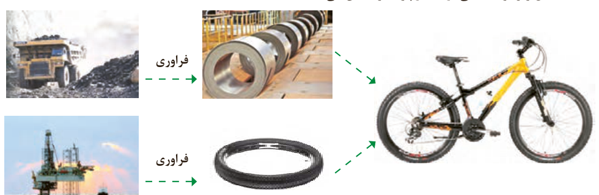
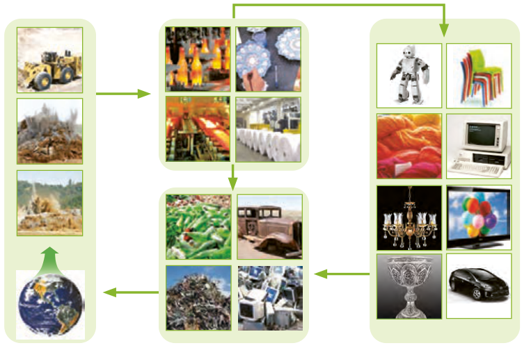

## خود را بیازمایید

۱- شکل زیر فرایند کلی تولید دوچرخه را نشان می‌دهد.

الف) درباره این فرایند گفت‌وگو کنید.

ب) آیا در فرایند تولید ورقه‌های فولادی و تایر دوچرخه، موادی دور ریخته می‌شوند؟

پ) با گذشت زمان چه اتفاقی برای قطعه‌های دوچرخه می‌افتد؟

۲- شکل زیر نمایی از چرخه مواد را نشان می‌دهد. با توجه به آن به پرسش‌ها پاسخ دهید.

الف) آیا جمله «همه مواد طبیعی¹ و ساختگی² از کره زمین به دست می‌آیند» درست است؟ توضیح دهید.

۱- Natural Material  
۲- Synthetic Material, Man Made
