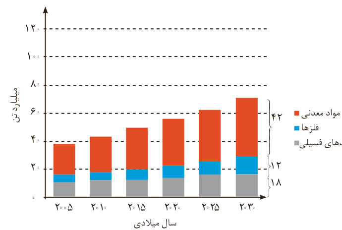

ب) موادی که از طبیعت به دست می‌آوریم، به چه شکلی به طبیعت باز می‌گردند؟

پ) آیا به تقریب جرم کل مواد در کره زمین ثابت می‌ماند؟ چرا؟

ت) برخی بر این باورند که «هر چه میزان بهره‌برداری از منابع یک کشور بیشتر باشد، آن کشور توسعه یافته‌تر است.» این دیدگاه را در کلاس نقد کنید.

۳- نمودار زیر برآورد میزان تولید یا مصرف نسبی برخی مواد را در جهان نشان می‌دهد.

با توجه به نمودار:

الف) در سال ۲۰۱۵ به تقریب چند میلیارد تن فلز در جهان استخراج و مصرف شده است؟

ب) پیش‌بینی می‌شود که در سال ۲۰۳۰ به تقریب در مجموع چند میلیارد تن از این مواد استخراج و مصرف شوند؟

پ) درباره این جمله که: «زمین منبع عظیمی از هدایای ارزشمند و ضروری برای زندگی است» گفت‌وگو کنید.

## آیا می‌دانید

سالانه بیش از ۷۰ میلیارد تن از منابع انرژی، سوخت‌های فسیلی، فلز و منابع شیمیایی از زمین استخراج می‌شود. با این توصیف مصرف سرانه هدایای ذخیره شده در زمین، حدود ده تن است.

دریافتید که زندگی روزانه ما به منابع شیمیایی وابسته است. صبحانه امروز خود را در نظر بگیرید، چای خود را با استکانی شیشه‌ای نوشیده‌اید که از شن و ماسه ساخته شده است، در ظرفی که از خاک چینی ساخته شده است، غذا خورده‌اید و برای هم زدن چای از قاشقی استفاده کرده‌اید که از فولاد زنگ‌نزن ساخته شده است. فولادی که پس از طی مراحل طولانی از سنگ معدن به دست می‌آید. همچنین برای طعم دادن به غذای خود، نمک به دست آمده از خشکی و دریا را روی آن پاشیده‌اید؛ سبزیجات و میوه‌هایی را خورده‌اید که با استفاده از کودهای پتاسیم، نیتروژن و فسفردار رشد کرده‌اند. از سوی دیگر، سوختی را که با
