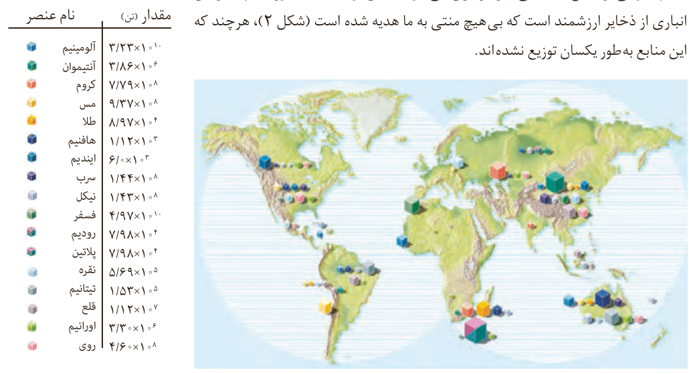

استفاده از آن خانه را گرم یا باک خودرو را پر می‌کنید، از دل زمین بیرون کشیده‌اند.

با پیشرفت صنعت، شهرها و روستاها گسترش یافتند و سطح رفاه در جامعه بالاتر رفت. با این روند میزان مصرف منابع گوناگون نیز افزایش یافت، به گونه‌ای که امروزه همه افراد جامعه در پی استفاده از تلفن همراه، خودروی شخصی و انواع وسایل الکترونیکی هستند. تأمین این نیازها به همراه تولید انواع دستگاه‌ها و ابزارآلات صنعتی، نظامی، کشاورزی و دارویی، سبب شده است تا تقاضای جهانی برای استفاده از هدایای زمینی افزایش یابد، به گونه‌ای که سالانه حجم انبوهی از منابع شیمیایی بهره‌برداری می‌شود. با این توصیف باید باور کنیم که زمین انباری از ذخایر ارزشمند است که بی‌هیچ منتی به ما هدیه شده است (شکل ۲)، هرچند که این منابع به‌طور یکسان توزیع نشده‌اند.

## آیا می‌دانید

برآورد مقدار برخی عنصرها در جهان:

شکل ۲- نمایش توزیع برخی عنصرها در جهان. آیا پراکندگی چنین منابعی می‌تواند دلیلی بر پیدایش تجارت جهانی باشد؟ توضیح دهید.

## در میان تارنماها

با مراجعه به منابع اینترنتی معتبر درباره میزان مصرف منابع شیمیایی گوناگون در جهان اطلاعاتی را جمع‌آوری کنید و به کلاس گزارش دهید.

اکنون این پرسش مطرح می‌شود که این هدایای زمینی به چه شکلی استفاده می‌شوند؟ آیا آنها به همان شکل مصرف می‌شوند یا آنها را به عنصرهای سازنده تبدیل می‌کنند، سپس به کار می‌برند؟ چگونه می‌توان تشخیص داد که در یک نمونه سنگ معدن، کدام عنصرها وجود
