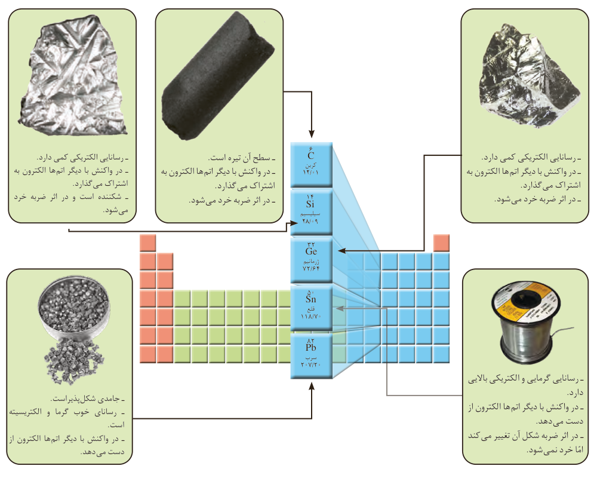

شکل ۳- برخی کاربرد فلزها مبتنی بر ویژگی آنها. هر کاربرد کدام ویژگی فلز را نشان می‌دهد؟

## با هم بیندیشیم

در شکل‌های زیر، عنصرهای گروه چهاردهم و عنصرهای دوره سوم جدول دوره‌ای همراه با برخی ویژگی‌های آنها نشان داده شده است. با بررسی آنها به پرسش‌ها پاسخ دهید.

الف) عنصرهای گروه ۱۴

کربن: سطح آن تیره است؛ در واکنش با دیگر اتم‌ها الکترون به اشتراک می‌گذارد؛ در اثر ضربه خرد می‌شود.

سیلیسیم: رسانایی الکتریکی کمی دارد؛ در واکنش با دیگر اتم‌ها الکترون به اشتراک می‌گذارد؛ شکننده است و در اثر ضربه خرد می‌شود.

ژرمانیم: رسانایی الکتریکی کمی دارد؛ در واکنش با دیگر اتم‌ها الکترون به اشتراک می‌گذارد؛ در اثر ضربه خرد می‌شود.

قلع: رسانایی گرمایی و الکتریکی بالایی دارد؛ در واکنش با دیگر اتم‌ها الکترون از دست می‌دهد؛ در اثر ضربه شکل آن تغییر می‌کند اما خرد نمی‌شود.

سرب: جامدی شکل‌پذیر است؛ رسانای خوب گرما و الکتریسیته است؛ در واکنش با دیگر اتم‌ها الکترون از دست می‌دهد.
