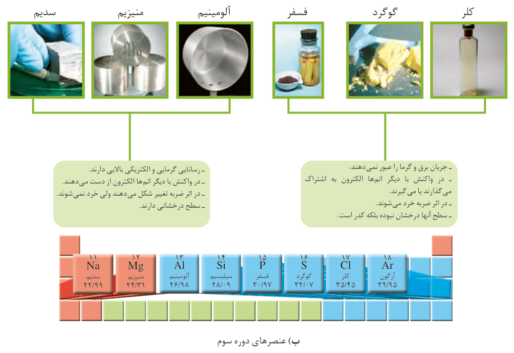

ب) عنصرهای دوره سوم

سدیم، منیزیم، آلومینیم: رسانایی گرمایی و الکتریکی بالایی دارند؛ در واکنش با دیگر اتم‌ها الکترون از دست می‌دهند؛ در اثر ضربه تغییر شکل می‌دهند ولی خرد نمی‌شوند؛ سطح درخشانی دارند.

فسفر، گوگرد، کلر: جریان برق و گرما را عبور نمی‌دهند؛ در واکنش با دیگر اتم‌ها الکترون به اشتراک می‌گذارند یا می‌گیرند؛ در اثر ضربه خرد می‌شوند؛ سطح آنها درخشان نبوده بلکه کدر است.

۱- در شکل «الف» سطح کدام عنصرها براق و صیقلی است؟

۲- در شکل «الف» کدام عنصرها ویژگی‌های مشترک بیشتری با یکدیگر دارند (رفتارهای فیزیکی و شیمیایی آنها شبیه هم هستند)؟

۳- شکل‌های «الف» و «ب» را با هم مقایسه و مشخص کنید رفتار کدام عنصرها به یکدیگر شباهت بیشتری دارند. نتیجه مقایسه خود را یادداشت کنید.

۴- با کامل کردن جدول صفحه بعد به یک جمع‌بندی از یافته‌های خود برسید و عنصرهای مشخص شده در بالا را در سه دسته فلز، نافلز و شبه فلز قرار دهید.
