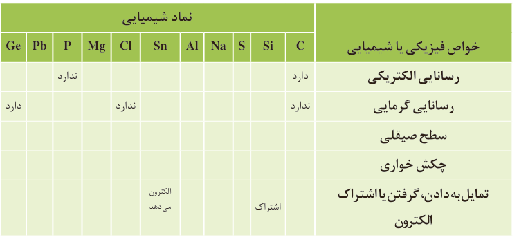

| خواص فیزیکی یا شیمیایی | C | Si | S | Na | Al | Sn | Cl | Mg | P | Pb | Ge |
|---|---|---|---|---|---|---|---|---|---|---|---|
| رسانایی الکتریکی | دارد | | | | | | | | ندارد | | |
| رسانایی گرمایی | ندارد | | | | | | ندارد | | | | دارد |
| سطح صیقلی | | | | | | | | | | | |
| چکش‌خواری | | | | | | | | | | | |
| تمایل به دادن، گرفتن یا اشتراک الکترون | | اشتراک | | | | الکترون می‌دهد | | | | | |

۵- در گروه ۱۴ از بالا به پایین، خصلت فلزی چه تغییری کرده است؟

۶- روند تغییر خصلت فلزی¹ و نافلزی² در دوره سوم جدول را بررسی کنید.

۷- پیش‌بینی کنید کدام عنصر در گروه اول جدول دوره‌ای خصلت فلزی بیشتری دارد.

۸- عبارت زیر را با خط زدن واژه نادرست در هر مورد، کامل کنید.

در هر دوره از جدول دوره‌ای، از چپ به راست از خاصیت (فلزی / نافلزی) کاسته و به خاصیت (نافلزی / فلزی) افزوده می‌شود. در گروه‌های ۱۵، ۱۶ و ۱۷ عنصرهای (بالاتر / پایین‌تر) خاصیت نافلزی بیشتری دارند زیرا از بالا به پایین خاصیت (نافلزی / فلزی) زیاد می‌شود.

فلزهای قلیایی جدول دوره‌ای: لیتیم، سدیم، پتاسیم، روبیدیم، سزیم، فرانسیم.

## آیا می‌دانید

گسترش صنایع الکترونیک و ساخت انواع وسایل و دستگاه‌های الکترونیکی مانند تلویزیون، رایانه، تلفن همراه و ماشین حساب مدیون ویژگی نیمه‌رسانایی عنصر سیلیسیم است.

بیشتر عنصرهای جدول دوره‌ای را فلزها تشکیل می‌دهند که به‌طور عمده در سمت چپ و مرکز جدول قرار دارند. اما نافلزها در سمت راست و بالای جدول چیده شده‌اند. شبه فلزها همانند مرزی بین فلزها و نافلزها قرار دارند. خواص فیزیکی شبه فلزها بیشتر به فلزها شبیه بوده در حالی که رفتار شیمیایی آنها همانند نافلزها است.

دیدید که خصلت فلزی در یک دوره از چپ به راست کاهش می‌یابد و در یک گروه از بالا به پایین افزایش می‌یابد. این روند در دیگر گروه‌ها و دوره‌ها نیز مشاهده می‌شود. به دیگر سخن خواص فیزیکی و شیمیایی عنصرها به‌صورت دوره‌ای تکرار می‌شود که به **قانون دوره‌ای عنصرها**³ معروف است.

۱- Metallic Property  
۲- Nonmetallic Property  
۳- Elements Periodic Law
