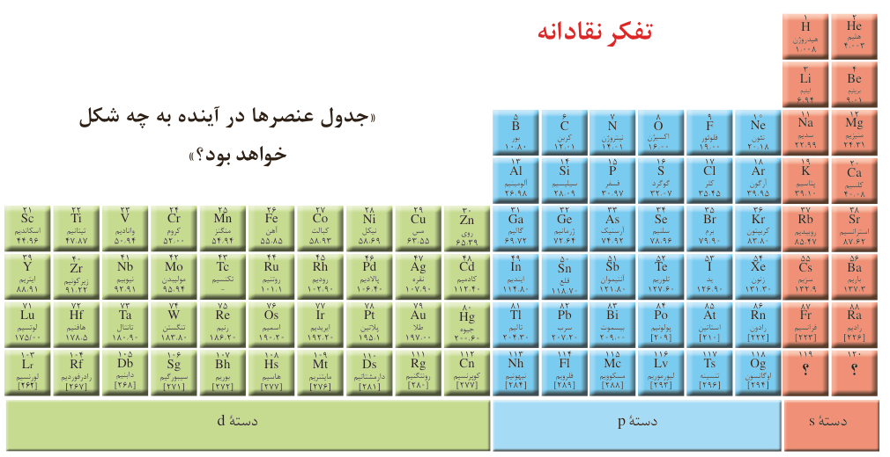

## تفکر نقادانه

«جدول عنصرها در آینده به چه شکل خواهد بود؟»

می‌دانید که همه ۱۱۸ عنصر جدول دوره‌ای شناسایی و توسط آیوپاک تأیید شده است، به‌طوری که هیچ خانه‌ای در جدول خالی نیست. بنابراین چنین به نظر می‌رسد که جست‌وجو برای کشف عنصرهای طبیعی به پایان رسیده و تنها راه افزایش شمار عنصرها، تهیه و تولید آنها به‌صورت ساختگی است. شاید شما نیز گزارش‌هایی درباره ساخت و شناسایی عنصر شماره ۱۲۰ یا ۱۲۱ در آزمایشگاه‌های تحقیقاتی و مدرن شنیده باشید. شناسایی عنصرها با عدد اتمی بیشتر از ۱۱۸ سبب خواهد شد تا طبقه‌بندی تازه‌ای از عنصرها ارائه شود زیرا در جدول دوره‌ای امروزی، جایی برای آنها پیش‌بینی نشده است. در صورت کشف این عنصرها، آنها را در کجای جدول قرار می‌دهید؟ چگونه و بر چه اساسی آنها را طبقه‌بندی خواهید کرد؟

شارل ژانت شیمی‌دان فرانسوی در سال ۱۹۲۷ با کنار هم چیدن عنصرهای شناخته شده در زمان خود، الگویی ارائه کرد که بر اساس آن می‌توان عنصرهای با عدد اتمی بزرگ‌تر از ۱۱۸ را نیز طبقه‌بندی کرد.

الف) درباره این طبقه‌بندی، ملاک آن، روندهای دوره‌ای، شمار عنصرهای دسته g و ... در کلاس گفت‌وگو و جدول را از جنبه‌های گوناگون نقد کنید.

ب) شما چه جدولی پیشنهاد می‌کنید؟ توضیح دهید.

## رفتار عنصرها و شعاع اتم¹

رفتارهای فیزیکی فلزها شامل داشتن جلا، رسانایی الکتریکی و گرمایی، خاصیت

۱- Atomic Radius
