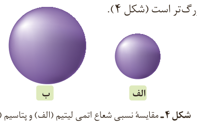

جدول پیشنهادی شارل ژانت (۱۹۳۲–۱۸۴۹ میلادی) با مدل کوانتومی همخوانی داشت. در دو ردیف جدید این جدول، زیرلایه g به عنوان زیرلایه پنجم پس از زیرلایه‌های s، p، d و f پر می‌شود.

چکش‌خواری، شکل‌پذیری (مانند قابلیت ورقه و مفتول شدن) و... است. در حالی که رفتار شیمیایی فلزها به میزان توانایی اتم آنها به از دست دادن الکترون وابسته است. هر چه اتم فلزی در شرایط معین آسان‌تر الکترون از دست بدهد، خصلت فلزی بیشتری دارد و **فعالیت شیمیایی**¹ آن بیشتر است.

روندهای تناوبی در جدول بر اساس کمیت‌های وابسته به اتم قابل توضیح است. یکی از این کمیت‌ها، شعاع اتمی است. در شیمی دهم آموختید که مطابق مدل کوانتومی، اتم را مانند کره‌ای در نظر می‌گیرند که الکترون‌ها پیرامون هسته و در لایه‌های الکترونی در حال حرکت‌اند. بنابراین می‌توان برای هر اتم شعاعی در نظر گرفت و آن را اندازه‌گیری کرد. بدیهی است که شعاع اتم‌های مختلف، یکسان نیست و هرچه شعاع یک اتم بزرگ‌تر باشد، اندازه آن اتم نیز بزرگ‌تر است (شکل ۴).

شکل ۴- مقایسه نسبی شعاع اتمی لیتیم (الف) و پتاسیم (ب).

آیا میان شعاع اتم‌ها و خصلت فلزی یا نافلزی آنها رابطه‌ای هست؟ اکنون با انجام دادن فعالیت صفحه بعد به رابطه بین خصلت فلزی و نافلزی با شعاع اتم پی می‌برید.

## آیا می‌دانید

تعیین اندازه اتم همانند جرم آن بسیار دشوار است. برای برخی اتم‌ها نصف فاصله بین هسته‌های دو اتم یکسان در پیوند اشتراکی یگانه را شعاع اتم در نظر می‌گیرند. برای نمونه:

شعاع اتم برم $=\frac{228\,\mathrm{pm}}{2}=114\,\mathrm{pm}$

$1\,\mathrm{pm}=10^{-12}\,\mathrm{m}$

۱- Chemical Reactivity
