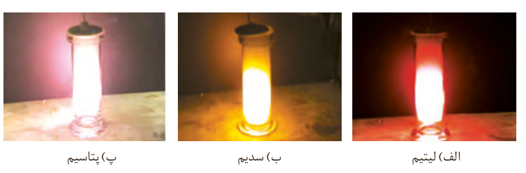

## با هم بیندیشیم

۱- با توجه به جایگاه عنصرهای لیتیم، سدیم و پتاسیم (فلزهای قلیایی¹) در جدول دوره‌ای، پیش‌بینی کنید در واکنش با گاز کلر، اتم‌های کدام‌یک آسان‌تر الکترون از دست خواهد داد؟ چرا؟

۲- تصویر زیر واکنش این فلزها با گاز کلر را در شرایط یکسان نشان می‌دهد. آیا داده‌های این تصویر پیش‌بینی شما را تأیید می‌کند؟ (راهنمایی: هرچه ماده‌ای سریع‌تر و شدیدتر واکنش بدهد، فعالیت شیمیایی بیشتری دارد.)

الف) لیتیم؛ ب) سدیم؛ پ) پتاسیم

۳- به نظر شما آیا جمله «هرچه شعاع اتمی یک فلز بزرگ‌تر باشد، آسان‌تر الکترون از دست می‌دهد» درست است؟ چرا؟

۴- جدول زیر را کامل کنید و توضیح دهید بین شمار لایه‌های الکترونی با شعاع اتم چه رابطه‌ای وجود دارد.

| نماد شیمیایی عنصر | $_3\mathrm{Li}$ | $_{11}\mathrm{Na}$ | $_{19}\mathrm{K}$ |
|---|---|---|---|
| آرایش الکترونی فشرده | | | |
| نماد آخرین زیرلایه | | | |
| تعداد لایه‌های الکترونی در اتم | | | |
| شعاع اتمی (pm) | ۱۵۲ | ۱۸۶ | ۲۳۱ |

۵- با توجه به جدول زیر پیش‌بینی کنید اتم کدام‌یک از فلزهای گروه دوم (فلزهای قلیایی خاکی²) جدول دوره‌ای در واکنش با نافلزها، آسان‌تر به کاتیون $\mathrm{M}^{2+}$ تبدیل می‌شود. چرا؟

| نام و نماد شیمیایی فلز | Mg (منیزیم) | Ca (کلسیم) | Sr (استرانسیم) |
|---|---|---|---|
| شعاع اتمی (pm) | ۱۶۰ | ۱۹۷ | ۲۱۵ |

## آیا می‌دانید

شعاع دسته دیگری از اتم‌ها به روش زیر اندازه‌گیری می‌شود. برای نمونه شعاع اتم سدیم برابر با ۱۸۶ پیکومتر است؛ فاصله دو هسته ۳۷۲ pm است.

تولید نور، آزادسازی گرما، تشکیل رسوب و خروج گاز نشانه‌هایی از تغییر شیمیایی هستند. هرچه شدت نور یا آهنگ خروج گاز آزاد شده بیشتر باشد، واکنش شیمیایی سریع‌تر و شدیدتر بوده و واکنش‌دهنده فعالیت شیمیایی بیشتری دارد.

۱- Alkaline Metals  
۲- Alkaline Earth Metals
