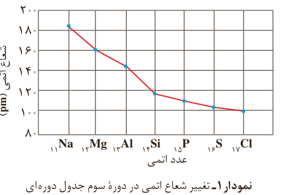

یکی دیگر از روندهای تناوبی، روند تغییر شعاع اتمی عنصرهای جدول دوره‌ای است. در یک گروه، از بالا به پایین شعاع اتمی افزایش می‌یابد، زیرا تعداد لایه‌های الکترونی بیشتر می‌شود. در حالی که در یک دوره، شعاع اتمی عنصرها از چپ به راست کاهش می‌یابد؛ زیرا در یک دوره، تعداد لایه‌های الکترونی ثابت می‌ماند در حالی که تعداد پروتون‌های هسته افزایش می‌یابد. با افزایش تعداد پروتون‌ها، نیروی جاذبه‌ای که هسته به الکترون‌ها وارد می‌کند افزایش یافته و بدین ترتیب شعاع اتم کاهش می‌یابد (نمودار ۱).

نمودار ۱- تغییر شعاع اتمی در دوره سوم جدول دوره‌ای

نافلزها در واکنش‌های شیمیایی برخلاف فلزها تمایل دارند با گرفتن الکترون به آنیون تبدیل شوند. برای مثال نافلزهای گروه ۱۷ (هالوژن‌ها) با گرفتن یک الکترون به آنیون با یک بار منفی (یون هالید¹) تبدیل می‌شوند.

## خود را بیازمایید

الف) جدول زیر را کامل کنید.

| نماد شیمیایی عنصر | $_9\mathrm F$ | $_{17}\mathrm{Cl}$ | $_{35}\mathrm{Br}$ |
|---|---|---|---|
| آرایش الکترونی فشرده | | | |
| نماد آخرین زیرلایه | | | |
| تعداد لایه‌های الکترونی در اتم | | | |
| شعاع اتمی (pm) | ۷۱ | ۹۹ | ۱۱۴ |

ب) پیش‌بینی کنید در شرایط یکسان کدام هالوژن واکنش‌پذیرتر است. چرا؟

در تولید لامپ چراغ‌های جلوی خودروها، از هالوژن‌ها استفاده می‌شود.

۱- Halide Ion
