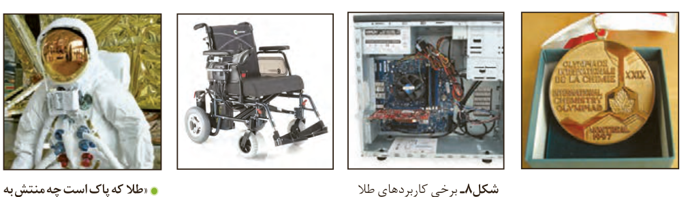

## پیوند با صنعت

هر کجا که هستید به اطراف خود نگاهی بیندازید، آیا جسم یا وسیله‌ای می‌بینید که از جنس طلا باشد یا در ساختن آن از طلا استفاده شده باشد؟ شاید به دنبال زیورآلاتی مانند گردن‌بند، انگشتر، دستبند، گنبد طلایی یا مواردی مشابه می‌گردید. آیا فلز طلا را می‌توان در وسایل دیگر نیز یافت؟ طلا فلزی ارزشمند و گران‌بها است که افزون بر ویژگی‌های مشترک فلزها، ویژگی‌های منحصر به‌فردی نیز دارد. فلز طلا به اندازه‌ای چکش‌خوار و نرم است که چند گرم از آن را می‌توان با چکش‌کاری به صفحه‌ای با مساحت چند متر مربع تبدیل کرد.

شکل ۸- برخی کاربردهای طلا

به همین دلیل ساخت برگ‌ها و رشته سیم‌های بسیار نازک (نخ طلا) به‌راحتی امکان‌پذیر است. رسانایی الکتریکی بالای طلا و حفظ این رسانایی در شرایط دمایی گوناگون، همچنین واکنش ندادن آن با گازهای موجود در هواکره و مواد موجود در بدن انسان همراه با بازتاب زیاد پرتوهای خورشیدی از جمله ویژگی‌های خاص طلاست که سبب شده کاربردهای این فلز گسترش یافته و تقاضای جهانی آن روزبه‌روز افزایش یابد (شکل ۸).

هر چند طلا در طبیعت به شکل فلزی و عنصری خود نیز یافت می‌شود، اما مقدار آن در معادن طلا بسیار کم است. به‌طوری که برای استخراج مقدار کمی از آن باید از حجم انبوهی خاک معدن استفاده کرد. به همین دلیل پسماند بسیار زیادی تولید می‌شود. برای نمونه، در تولید مقدار طلای مورد نیاز برای ساخت یک عدد حلقه عروسی حدود سه تن پسماند ایجاد می‌شود. از این رو استخراج طلا همانند دیگر فعالیت‌های صنعتی آثار زیان‌بار زیست‌محیطی بر جای می‌گذارد. امید است که در پیوند صنعت با دانشگاه و انجام پژوهش‌های مناسب، راه‌هایی برای استخراج فلزها پیدا شود که ضمن بهره‌برداری از منابع، منجر به کاهش ردپای محیط زیستی شده و هماهنگ با توسعه پایدار باشد. مجتمع طلای موته در اصفهان و زرشوران در آذربایجان غربی از منابع استخراج طلا در ایران هستند.

## آیا می‌دانید

در خاک معدن طلای زرشوران، میزان طلا حدود ۴ ppm است. به دیگر سخن در هر تن خاک این معدن، حدود ۴ گرم طلا وجود دارد. در مجتمع طلای موته اصفهان نیز سالانه حدود ۳۰۰ کیلوگرم طلا استخراج می‌شود.

«طلا که پاک است چه منتش به خاک است» یک ضرب‌المثل ایرانی است اما یک مفهوم شیمیایی را بیان می‌کند. در مورد آن گفت‌وگو کنید.

سالانه در حدود ۴۰۰۰ تن طلا در جهان برای استفاده‌های گوناگون مانند موارد زیر، استخراج و تولید می‌شود:

| کاربرد | مقدار (تن) |
|---|---|
| زیورآلات و جواهرات | ۲۳۹۸/۷ |
| پشتوانه ارزی | ۲۵۳/۳ |
| الکترونیک | ۳۱۰/۶ |
| دندان‌پزشکی | ۵۷/۳ |
| صنایع دیگر | ۷۵۰ |
