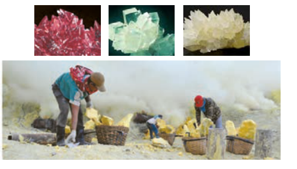
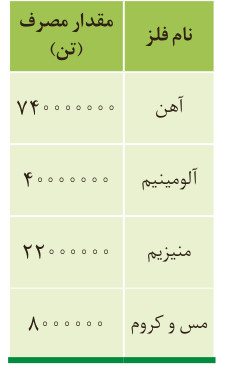

## عنصرها به چه شکلی در طبیعت یافت می‌شوند؟

یافته‌ها نشان می‌دهد که اغلب عنصرها در طبیعت به شکل ترکیب یافت می‌شوند، هرچند برخی نافلزها مانند اکسیژن، نیتروژن، گوگرد و... به شکل آزاد در طبیعت وجود دارند و وجود نمونه‌هایی از فلزهای نقره، مس، پلاتین نیز در طبیعت گزارش شده است. البته در میان فلزها، تنها طلا به شکل کلوخه‌ها یا رگه‌های زرد لابه‌لای خاک یافت می‌شود (شکل ۹).

شکل ۹- نمونه‌هایی از کانی‌ها (کلسیم کربنات، سدیم کلرید، منگنز (II) کربنات، گوگرد). فرمول شیمیایی هر یک از این مواد را بنویسید.

در دنیای مدرن و صنعتی امروزی، از فلزهای بسیار زیادی استفاده می‌شود آن‌چنان که چرخ‌های اقتصادی کشورها به تولید و مصرف این مواد گره خورده است (شکل ۱۰).

شکل ۱۰- کاربرد فلزهای گوناگون در زندگی

آهن فلزی است که در سطح جهان بیشترین مصرف سالانه را در بین صنایع گوناگون دارد. در کشور ما نیز مصرف آهن بسیار زیاد است. همان‌طور که می‌دانید آهن اغلب در طبیعت به شکل اکسید یافت می‌شود. اکنون این پرسش مطرح می‌شود که چگونه می‌توان وجود آهن را در سنگ معدن شناسایی و به چه روشی می‌توان آن را استخراج کرد؟ شیمی‌دان‌ها با بررسی دقیق مواد، رفتار آنها را می‌شناسند تا پاسخ این‌گونه پرسش‌ها را بیابند. یکی از حوزه‌های پرکاربرد و اقتصادی علم شیمی، یافتن راه‌های گوناگون و مناسب برای استخراج و تولید عنصرها از طبیعت است.

## آیا می‌دانید

بیشتر فلزها به شکل سولفید یا اکسید در طبیعت وجود دارند.

سالانه مقدار قابل توجهی فلز در سطح دنیا تولید و مصرف می‌شود. جدول زیر مقدار مصرف سالانه چند فلز را نشان می‌دهد.

| نام فلز | مقدار مصرف (تن) |
|---|---|
| آهن | ۷۴۰۰۰۰۰۰۰ |
| آلومینیم | ۴۰۰۰۰۰۰۰ |
| منیزیم | ۲۲۰۰۰۰۰ |
| مس و کروم | ۸۰۰۰۰۰۰ |

