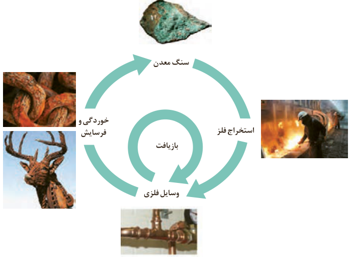

صدها میلیون تن فلز از دل زمین استخراج می‌شود. سپس از این فلزها، ابزار، وسایل و مواد گوناگونی تهیه می‌شود. در شیمی دهم آموختید که بر اساس توسعه پایدار باید در تولید یک ماده یا عرضه خدمات، همه هزینه‌ها و ملاحظه‌های اقتصادی، اجتماعی و زیست‌محیطی را در نظر گرفت. به‌طوری که اگر مجموع هزینه‌های بهره‌برداری از یک معدن با در نظر گرفتن این ملاحظه‌ها، کمترین مقدار ممکن باشد، در آن صورت در مسیر پیشرفت پایدار حرکت می‌کنیم؛ یعنی رفتارهای ما، آسیب کمتری به جامعه‌ای که در مسیر حفظ محیط زیست است، وارد می‌کند و ردپای زیست‌محیطی ما را کاهش می‌دهد. با این روند در استفاده درست از این هدایای زمینی و نگه‌داری آنها برای آیندگان موفق خواهیم شد.

دیگران کاشتند و ما خوردیم، ما بکاریم تا دیگران بخورند.

جامعه‌ای در مسیر توسعه پایدار است که اقتصاد آن شکوفا باشد، در عین حال به محیط زیست آسیب کمتری بزند و مردم به اخلاق آراسته و به خوش‌نامی معروف باشند. امید است با گسترش شرکت‌های دانش‌بنیان با همت جوانان خلاق، متعهد و کوشای کشورمان بتوانیم در تحقق آرمان‌های نظام آموزشی کشورمان پیش برویم.

## با هم بیندیشیم

در شکل زیر فرایند استخراج¹ فلز از طبیعت و بازگشت آن به طبیعت نشان داده شده است. با گفت‌وگو درباره آن، پاسخ پرسش‌های زیر را بیابید.

الف) آیا آهنگ مصرف و استخراج فلز با آهنگ بازگشت فلز به طبیعت به شکل سنگ معدن یکسان است؟ توضیح دهید.

ب) فلزها، منابعی تجدیدپذیرند یا تجدیدناپذیر؟ چرا؟

۱- Extraction
