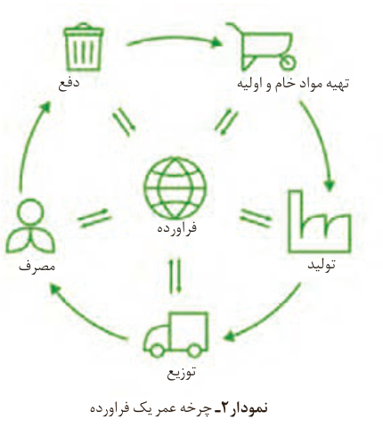

در استخراج ۱۰۰۰ کیلوگرم آهن، تقریباً ۲۰۰۰ کیلوگرم سنگ معدن آهن و ۱۰۰۰ کیلوگرم از منابع معدنی دیگر استفاده می‌شود. در استخراج فلز تنها درصد کمی از سنگ معدن به فلز تبدیل می‌شود.

پسماند سرانه سالانه فولاد ۴۰ کیلوگرم است. از بازگردانی هفت قوطی فولادی آنقدر انرژی ذخیره می‌شود که می‌توان یک لامپ ۶۰ واتی را در حدود ۲۵ ساعت روشن نگه داشت.

پ) درباره شکل بالا گفت‌وگو و مشخص کنید کدام عبارت‌ها درست و کدام‌ها نادرست‌اند؟ چرا؟

بازیافت فلزها و از جمله فلز آهن:

● ردپای کربن دی‌اکسید را کاهش می‌دهد.  
● سبب کاهش سرعت گرمایش جهانی می‌شود.  
● گونه‌های زیستی بیشتری را از بین می‌برد.  
● به توسعه پایدار کشور کمک می‌کند.

## پیوند با زندگی

امروزه پژوهشگران از ارزیابی چرخه عمر¹ برای میزان تأثیر یک فرآورده بر محیط زیست در طول عمر آن بهره می‌برند؛ چرخه‌ای با پنج مرحله حاوی تهیه مواد خام و اولیه، تولید، توزیع، مصرف و دفع (نمودار ۲).

با بررسی این چرخه برای یک فرآورده، میزان آب و انرژی مصرفی، ادامه فرایند بر اساس تأمین مواد خام و اولیه، میزان زباله و پسماند؛ همچنین هزینه حمل و نقل در هر مرحله بررسی می‌شود.

نمودار ۲- چرخه عمر یک فرآورده

۱- Life Cycle Assessment
