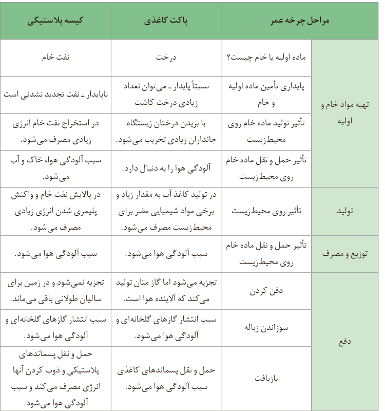

در واقع بررسی چنین چرخه‌ای کمک می‌کند تا صنایع گوناگون با بهره‌گیری از دانش فنی و تخصصی سازگارتر با محیط زیست در راستای دستیابی به توسعه پایدار پیش بروند. جدول زیر نمونه ساده‌ای از این چرخه برای یک کیسه پلاستیکی و پاکت کاغذی را نشان می‌دهد.

| مراحل چرخه عمر | پرسش یا اثر | پاکت کاغذی | کیسه پلاستیکی |
|---|---|---|---|
| تهیه مواد خام و اولیه | ماده اولیه یا خام چیست؟ | درخت | نفت خام |
| تهیه مواد خام و اولیه | پایداری تأمین ماده اولیه و خام | نسبتاً پایدار ـ می‌توان تعداد زیادی درخت کاشت | ناپایدار ـ نفت تجدید نشدنی است |
| تهیه مواد خام و اولیه | تأثیر تولید ماده خام روی محیط زیست | با بریدن درختان، زیستگاه جانوران زیادی تخریب می‌شود. | در استخراج نفت خام انرژی زیادی مصرف می‌شود. |
| تهیه مواد خام و اولیه | تأثیر حمل و نقل ماده خام روی محیط زیست | آلودگی هوا را به دنبال دارد. | سبب آلودگی هوا، خاک و آب می‌شود. |
| تولید | تأثیر روی محیط زیست | در تولید کاغذ آب به مقدار زیاد و برخی مواد شیمیایی مضر برای محیط زیست مصرف می‌شود. | در پالایش نفت خام و واکنش پلیمری شدن انرژی زیادی مصرف می‌شود. |
| توزیع و مصرف | تأثیر حمل و نقل ماده خام روی محیط زیست | سبب آلودگی هوا می‌شود. | سبب آلودگی هوا می‌شود. |
| دفع | دفن کردن | تجزیه می‌شود اما گاز متان تولید می‌کند که آلاینده هوا است. | تجزیه نمی‌شود و در زمین برای سالیان طولانی باقی می‌ماند. |
| دفع | سوزاندن زباله | سبب انتشار گازهای گلخانه‌ای و آلودگی هوا می‌شود. | سبب انتشار گازهای گلخانه‌ای و آلودگی هوا می‌شود. |
| دفع | بازیافت | حمل و نقل پسماندهای کاغذی سبب آلودگی هوا می‌شود. | حمل و نقل پسماندهای پلاستیکی و ذوب کردن آنها انرژی مصرف می‌کند و سبب آلودگی هوا می‌شود. |

## آیا می‌دانید

مقدار انرژی الکتریکی مصرف شده در چرخه عمر بطری‌های پلاستیکی و شیشه‌ای شیر چقدر است؟ جدول زیر برخی از این داده‌ها را نشان می‌دهد.

| نام فرایند | بطری پلاستیکی (نمی‌تواند دوباره استفاده شود) | بطری شیشه‌ای (می‌تواند دوباره استفاده شود) |
|---|---|---|
| تولید | ۴/۷ | ۷/۲ |
| شست‌وشو، پرکردن، توزیع | ۲/۲ | ۲/۵ |

انرژی الکتریکی مصرف شده (MJ) به ازای یک بطری معمولی.

## نفت، هدیه‌ای شگفت‌انگیز

در اواخر سده ۱۸ میلادی شیمی‌دان‌ها با ماده‌ای روبه‌رو شدند که رفتار آن به مواد شناخته شده تا آن زمان شبیه نبود؛ ماده‌ای که بعدها نفت خام¹ نامیده شد. این ماده یکی از سوخت‌های فسیلی است که به شکل مایع غلیظ سیاه رنگ یا قهوه‌ای متمایل به سبز از دل زمین بیرون کشیده می‌شود (شکل ۱۲).

شکل ۱۲- نفت خام مخلوطی از هیدروکربن‌هاست.

۱- Crude Oil
